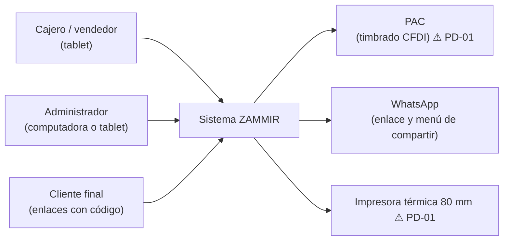
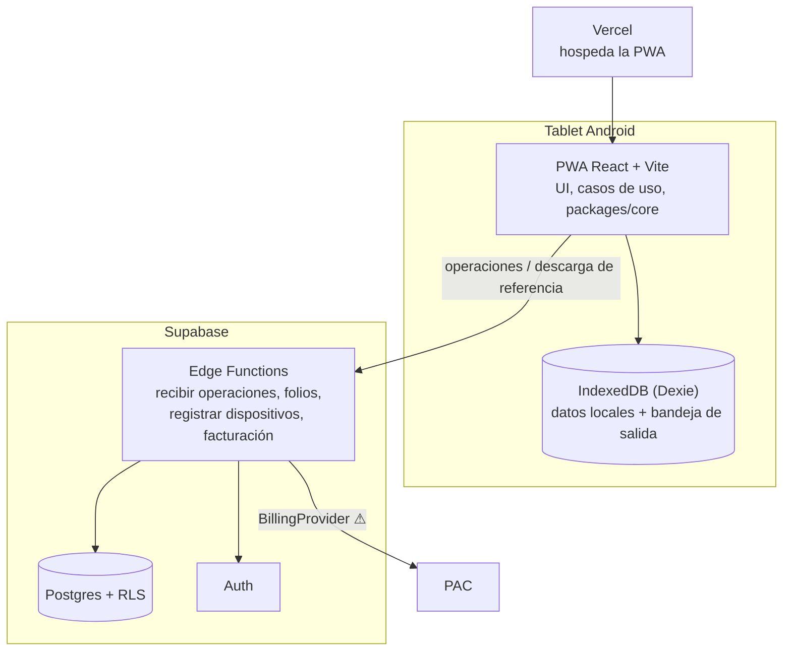
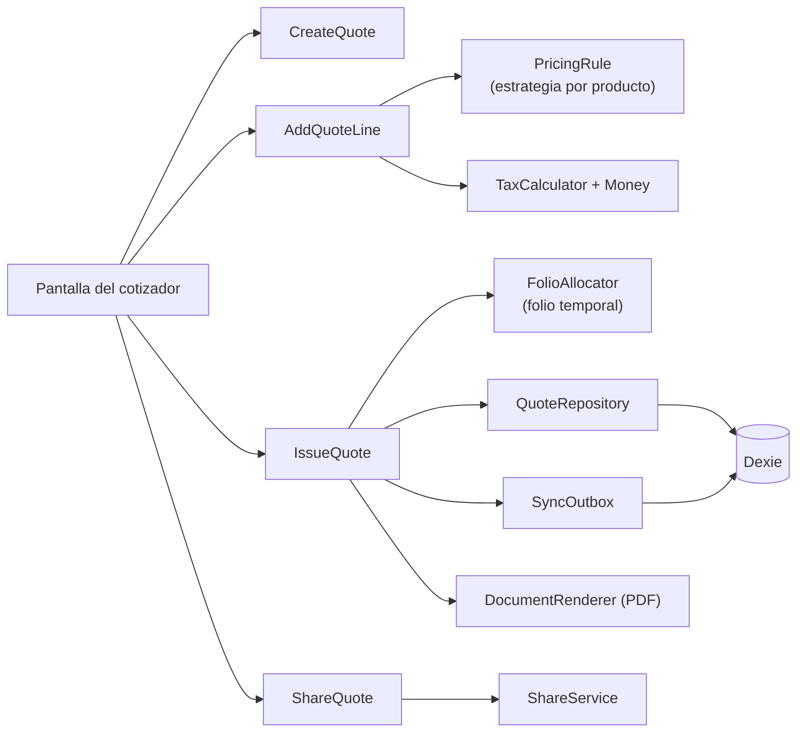

# Arquitectura

> Borrador de Fase 2. Decisiones: [ADR-0003], [ADR-0004], [ADR-0006], [ADR-0007], [ADR-0008], [ADR-0011], [ADR-0012], [ADR-0013], [ADR-0014], [ADR-0015], [ADR-0016]. Principios y reglas de dependencia: `docs/plan/00-principios-de-ingenieria.md`.
> Lo que depende de §7 (facturación) y §8 (impresión) está marcado ⚠ PD-01.

## 1. Idea central

El sistema trabaja **primero en la tablet**: todo se guarda en IndexedDB y se envía después. El servidor (Supabase) es la fuente de verdad contable: asigna folios definitivos, guarda lo enviado, reparte datos de referencia y atiende lo que exige conexión. La lógica del negocio vive en un paquete de TypeScript puro que usan los dos lados.

## 2. Contexto (C4 nivel 1)

## 3. Contenedores (C4 nivel 2)

- La PWA se sirve por HTTPS desde Vercel y se instala en la tablet [ADR-0008]. El mismo código sirve a administradores desde una computadora.
- El navegador nunca habla con Postgres directamente para escribir: usa funciones del servidor [ADR-0012, ADR-0013].

## 4. Capas y reglas de dependencia

Se confirma el estilo de `00-principios-de-ingenieria.md` §1.1: dominio → aplicación → infraestructura y UI → raíz de composición. Las dependencias solo apuntan hacia adentro y `dependency-cruiser` rompe la integración continua si se violan [ADR-0014].

| Ubicación | Capa | Puede importar |
|---|---|---|
| `packages/core/src/shared-kernel` | Dominio compartido (`Money`, `TaxCalculator`, `Folio`, `Clock`, `IdGenerator`, `Result`) | Nada externo |
| `packages/core/src/modules/<m>/domain` | Dominio del módulo | Dominio |
| `packages/core/src/modules/<m>/application` | Casos de uso y puertos | Dominio |
| `apps/web/src/modules/<m>/infra` y `shared/infra` | Adaptadores (Dexie, Supabase, PDF, impresora, compartir) | Aplicación, dominio, SDKs |
| `apps/web/src/modules/<m>/ui` y `shared/ui` | Pantallas y componentes | Aplicación, dominio (tipos y formato) |
| `apps/web/src/composition` | Raíz de composición | Todo |
| `supabase/functions` | Adaptadores de servidor | `packages/core` |

## 5. Módulos

| Módulo | Paquete en `core` | Notas |
|---|---|---|
| M1 Catálogo | `catalog` | Reglas de precio (`PricingRule`) como estrategias [ADR-0006] |
| M2 Cotizador | `quotes` | Congela el precio al emitir [RN-03]; PDF por `DocumentRenderer`; WhatsApp por `ShareService` |
| M3 Órdenes de trabajo | `work-orders` | Máquina de estados; anticipo, saldo y garantía |
| M4 Mostrador | `counter` | Ventas, tickets (`TicketPrinter`), corte de caja |
| M5 Clientes | `customers` | Ficha, historial, derechos sobre datos |
| M6 Cuentas por cobrar | `receivables` | Solo lectura sobre órdenes |
| M7 Reportes | `reports` | Un reporte = una definición independiente; base de cálculo en [RN-20] |
| M8 Usuarios y roles | `identity` | Política de permisos, PIN (`PinHasher`), dispositivos [ADR-0013] |
| M9 Legal | `legal` | Aviso y términos versionados |
| M10 Facturación | `billing` | `BillingProvider` (simulado y real) ⚠ PD-01 |
| Transversal | `shared-kernel`, `sync` | Dinero, folios, hora, cola de salida [ADR-0012] |

## 6. Puertos principales

Los de `00-principios` §1.3, sin cambios: `Clock`, `IdGenerator`, `<Entidad>Repository`, `SyncOutbox`, `FolioAllocator`, `DocumentRenderer`, `TicketPrinter`, `ShareService`, `BillingProvider`, `PinHasher`, `FeatureFlags`. Cada uno tiene pruebas de contrato que corren contra todos sus adaptadores.

## 7. Componentes del cotizador (C4 nivel 3)

- La pantalla solo muestra y captura. El importe y el desglose los calcula el dominio [RN-04, RN-07].
- Emitir una cotización la guarda con su folio temporal (`T1-0001`) y la encola. El servidor le asigna el definitivo (`COT-AAAA-0001`) al recibirla [RN-15, RN-16].

## 8. Flujo de una operación (resumen)

1. El caso de uso valida reglas y permisos con el usuario activo.
2. Guarda el documento y una operación con UUID en IndexedDB, en una transacción local.
3. El worker de envío manda la operación a la función del servidor, que la procesa una sola vez, asigna el folio definitivo y devuelve el resultado.
4. La tablet actualiza el folio y el estado "enviado". Mientras tanto la interfaz dice "Guardado en la tablet" [GLOSARIO].

Detalle en [`SINCRONIZACION.md`](SINCRONIZACION.md).

## 9. Dónde vive cada regla de negocio

Se completa con la tabla RN-01 a RN-20 → capa y pieza antes de cerrar la fase. Adelanto:

| Regla | Pieza |
|---|---|
| RN-02 | `PricingRule` y sus estrategias (dominio de `catalog`) |
| RN-03 | `IssueQuote` copia precios y desglose a la cotización |
| RN-05, 06, 07 | `Money`, `TaxCalculator` (dominio compartido) |
| RN-08 | Dominio de `work-orders` (anticipo) con `Money` |
| RN-15, 16 | `FolioAllocator` (puerto) y función de folios en servidor |
| RN-17 | Funciones de fecha en el dominio compartido, con `Clock` |
| RN-18, 19 | Bitácora como evento de aplicación; sin borrado en las tablas contables |

## 10. Qué falta de este documento
- Tabla completa RN-01 a RN-20 → pieza.
- Ajustes por §7 y §8 (PD-01).
- Aprobación de Juanito.
