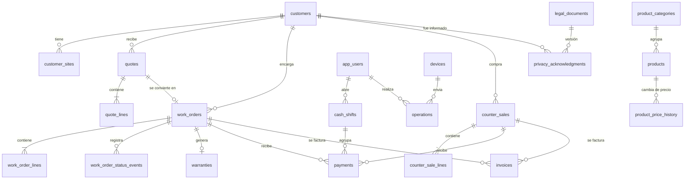

# Modelo de datos

> Borrador de Fase 2. Convenciones: [ADR-0015]. Operaciones y folios: [ADR-0016]. Autenticación: [ADR-0013]. Nombres en inglés según el glosario [ADR-0009].
> ⚠ PD-01: la tabla de facturas (M10) es provisional hasta recibir la §7.
> Este documento define **qué se guarda**; el detalle de columnas y tipos exactos se termina en las migraciones del Sprint 0 y 1, sin cambiar lo que aquí se decide.

## 1. Convenciones

| Tema | Regla |
|---|---|
| Identificadores | UUID generado en la tablet |
| Dinero | `*_cents bigint` |
| Tasas | puntos base enteros (`tax_rate_bps = 1600`) |
| Fechas y horas | `timestamptz` UTC; fechas de calendario como `date` en hora de México |
| Cambios | `created_at`, `created_by_user_id`, `device_id` en todo lo creado en la tablet; `change_seq` en lo que se replica |
| Borrado | No existe en lo contable; catálogo y usuarios se desactivan [RN-18] |
| Estados | Enumeraciones con transiciones validadas por la máquina de estados del dominio |

## 2. Diagrama entidad-relación (simplificado)

## 3. Entidades por módulo

### M1 Catálogo
| Tabla | Contenido clave |
|---|---|
| `product_categories` | Nombre, orden; datos fiscales predeterminados de la categoría (clave de producto o servicio, clave de unidad, objeto de impuesto) |
| `products` | `code` (opcional), `name`, `category_id`, `kind` (`CUSTOM`, `STANDARD`, `SERVICE`), `charge_unit` (m², metro lineal, pieza, servicio), `list_price_cents` (con IVA), `is_tax_exempt`, `is_active`, `warranty_months?`, `warranty_text?`, datos fiscales propios, `pricing_rule_type`, `pricing_rule_params` (JSON validado), `search_text` (sin acentos ni mayúsculas) |
| `product_price_history` | Producto, precio anterior y nuevo, usuario, fecha [RF-M1-06] |
| `stock_levels`, `stock_movements` | **Solo con P2 activo**: existencia, mínimo, movimientos por venta o entrega [RF-M1-07] |

### M5 Clientes
| Tabla | Contenido clave |
|---|---|
| `customers` | Nombre, WhatsApp o teléfono, `phone_normalized` (índice, no único, para avisar de duplicados), correo, notas, datos fiscales opcionales (RFC, razón social, CP fiscal, régimen, uso de CFDI), `anonymized_at?` |
| `customer_sites` | Domicilios de obra del cliente |
| `privacy_acknowledgments` | Cliente, versión del aviso, usuario, fecha [RF-M9-03] |

*Cliente recurrente* (dos o más trabajos entregados) es una vista, no una columna.

### M2 Cotizador
| Tabla | Contenido clave |
|---|---|
| `quotes` | `temp_folio`, `folio?`, `public_code`, `status` (borrador, enviada, aceptada, rechazada), `customer_id`, `site_id?`, `issued_at?`, `valid_until` (date), `conditions_text` (copia), versión del aviso y de los términos usados, `subtotal_cents`, `tax_cents`, `total_cents`, `catalog_version`, `converted_work_order_id?`, usuario y dispositivo |
| `quote_lines` | Instantánea del producto: nombre, unidad, precio unitario con IVA, tipo y parámetros de la regla de precio, medidas en mm, cantidad, `line_total_cents`, `base_cents`, `tax_cents`, `is_tax_exempt`, datos fiscales; detalle del cálculo mostrado al usuario |

*Vencida* se calcula con `valid_until`; no se guarda. Los borradores no tienen folio.

### M3 Órdenes de trabajo
| Tabla | Contenido clave |
|---|---|
| `work_orders` | `temp_folio`, `folio?`, `public_code`, `status` (en espera, en proceso, listo, entregado, cancelado), `customer_id`, `quote_id?`, descripción, totales congelados, `deposit_percent_bps` y `deposit_required_cents` (anticipo exigido, hacia arriba [ADR-0011]), responsables de medición, fabricación e instalación, fecha estimada de entrega, notas, `delivered_with_balance` con motivo y autorizador, datos de cancelación (motivo, usuario, autorizador, monto y trato del anticipo ⚠ PD-07) |
| `work_order_lines` | Igual que `quote_lines`, copiadas al crear la orden |
| `work_order_status_events` | Estado anterior y nuevo, usuario, dispositivo, hora, motivo, autorizador. Solo se agrega [RF-M3-02] |
| _(sin tabla)_ fotos de medición | Archivos en el bucket privado `order-photos`, ruta `<orden>/<foto>.jpg`; subida aparte de la cola [SINCRONIZACION §9, ADR-0025] |
| `warranties` | Orden, inicio, `duration_months?` (⚠ PD-06, configurable), cobertura, exclusiones [RF-M3-05] |

El **saldo** es total − pagos y vive en una vista.

### M4 Mostrador
| Tabla | Contenido clave |
|---|---|
| `counter_sales` | `temp_folio`, `folio?`, `public_code`, `status` (completada, cancelada), `customer_id?`, totales, usuario, dispositivo, `cash_shift_id`, datos de cancelación (motivo, usuario, autorizador; efecto en caja ⚠ PD-24) |
| `counter_sale_lines` | Igual que las demás líneas |
| `payments` | Destino (`work_order` o `counter_sale`), tipo (anticipo, saldo, venta), método (efectivo o transferencia), `amount_cents` aplicado, efectivo recibido y cambio (solo efectivo), referencia (transferencia), quién cobró, dispositivo, hora, `cash_shift_id`. El pago mixto son varias filas [RN-10] |
| `cash_shifts` | Cajero, dispositivo, apertura (fondo inicial), cierre (efectivo esperado, contado, diferencia), estado |
| `cash_shift_reopenings` | Administrador, motivo, hora [RF-M4-06] |

El corte de nivel 2 es una consulta de lectura sobre `cash_shifts` y `payments`.

### M6 y M7 Cuentas por cobrar y reportes
No tienen tablas propias: son **vistas** sobre órdenes, pagos, ventas y turnos. Todos los periodos se calculan en hora de México, semana de lunes a domingo [RN-17]. La base de "ventas" es efectivo recibido [RN-20, PD-08].

### M8 Usuarios, dispositivos y bitácora
| Tabla | Contenido clave |
|---|---|
| `app_users` | Nombre, `role` (`ADMIN`, `STAFF`), `is_active`, `auth_user_id?` (administradores), verificador del PIN (sal, iteraciones, verificador, versión) [ADR-0013] |
| `devices` | Nombre, `temp_series` (1, 2, …), `auth_user_id`, `status` (activo, revocado), alta, último envío |
| `device_registration_codes` | Hash del código, vigencia, uso, quién lo creó |
| `operations` | `op_id`, `device_id`, `seq`, `type`, `schema_version`, `payload`, usuario, autorizador, `client_created_at`, `received_at`, `status` (aplicada, por revisar, fallida), motivo, resultado [ADR-0016] |
| `audit_log` | Quién, dispositivo, cuándo, acción, entidad, valor anterior y nuevo, `op_id` [RN-19] |
| `folio_counters` | `doc_type`, `year`, `last_value` |

### M9 Legal y configuración
| Tabla | Contenido clave |
|---|---|
| `legal_documents` | Tipo (aviso de privacidad, términos), versión, fecha de vigencia, texto, quién lo editó |
| `business_settings` | Clave y valor validado por esquema: tasa de IVA, porcentaje de anticipo, vigencia de cotización, minutos de bloqueo, umbral de antigüedad, ventana de retención, leyenda y plazo de autofacturación (PD-09), datos y logo del negocio (PD-11), interruptores P1 y P2, valores de PD-21 y PD-22 |

### M10 Facturación ⚠ PD-01
| Tabla | Contenido clave (provisional) |
|---|---|
| `invoices` | `folio` (F-AAAA-0001), origen (orden o venta), copia de los datos fiscales del receptor, totales, `status` (borrador, timbrada, cancelada), UUID fiscal, proveedor, referencia al XML, quién la pidió y quién autorizó. Detalle al recibir §7 |

## 4. Cómo se congela el precio [RN-03]
Al emitir una cotización se copian a cada línea el nombre, la unidad, el precio, la regla de precio con sus parámetros y los datos fiscales, junto con los totales ya desglosados [ADR-0011]. La orden copia las líneas de la cotización. Después, el catálogo puede cambiar sin tocar ningún documento; `catalog_version` permite avisar, sin bloquear, que el precio cotizado ya no coincide con el actual.

## 5. Lo que no se borra [RN-18]
- Sin permiso de `DELETE` sobre cotizaciones emitidas, órdenes, ventas, pagos, turnos, facturas, operaciones y bitácora.
- Disparadores que impiden cambiar columnas inmutables (totales, líneas, montos, folio definitivo una vez asignado).
- Anonimizar un cliente [RF-M5-05] vacía sus datos personales y pone `anonymized_at`, sin tocar los documentos contables.

## 6. Acceso por rol (RLS)
Resumen; el detalle y las pruebas por rol están en `AUTENTICACION.md` §6.

| Tablas | Administrador | Dispositivo | Anónimo |
|---|---|---|---|
| Catálogo, configuración, usuarios activos, aviso | Lectura y escritura | Solo lectura | — |
| Clientes, cotizaciones, órdenes, ventas, pagos, turnos, garantías | Lectura | Solo mediante la función de operaciones | — |
| Operaciones, bitácora, dispositivos, folios | Lectura | Sin acceso directo | — |
| Facturas | Lectura y escritura por función de servidor | Sin acceso | Portal por código |

## 7. Qué se replica a la tablet
Ver `SINCRONIZACION.md` §2. Las tablas replicadas llevan `change_seq`. No se replican `operations`, `audit_log`, `folio_counters`, `devices`, `device_registration_codes` ni `invoices`.

## 8. Trazabilidad: requerimiento → entidad

| Requerimiento | Entidades |
|---|---|
| RF-M1-01 | `products`, `product_categories` |
| RF-M1-02 | `product_categories` (datos iniciales) |
| RF-M1-03 | `products.search_text` |
| RF-M1-04 | `products.is_active`, `audit_log` |
| RF-M1-05 | Importación sobre `products` (sin tabla propia; vista previa en memoria) |
| RF-M1-06 | `product_price_history` |
| RF-M1-07 (P2) | `stock_levels`, `stock_movements` |
| RF-M2-01 | `customers`, `customer_sites`, `quotes` |
| RF-M2-02 | `quote_lines` (medidas, cálculo) |
| RF-M2-03 | `quote_lines`, `audit_log` (descuentos, autorizador en `operations`) |
| RF-M2-04, 05, 06, 10 | Sin tablas propias: usan `quotes`, `quote_lines`, `business_settings`, `legal_documents` |
| RF-M2-07 | `quotes.status`, `valid_until` |
| RF-M2-08 | `quotes.converted_work_order_id`, `work_orders.quote_id` |
| RF-M2-09 | `quotes` en estado borrador |
| RF-M2-11 (P1) | `quotes.public_code`, interruptor en `business_settings` |
| RF-M3-01 | `work_orders`, `work_order_lines`, `work_order_photos` |
| RF-M3-02 | `work_orders.status`, `work_order_status_events` |
| RF-M3-03 | `payments`, vista de saldo |
| RF-M3-04 | `work_orders.delivered_with_balance`, `audit_log` |
| RF-M3-05 | `warranties` |
| RF-M3-06 | `work_orders.public_code`, `payments` |
| RF-M3-07 | Vistas sobre `work_orders` |
| RF-M3-08 | Datos de cancelación de `work_orders` (⚠ PD-07) |
| RF-M4-01, 02 | `counter_sales`, `counter_sale_lines`, `payments` |
| RF-M4-03 | `payments`, `counter_sales` (usuario, dispositivo, hora) |
| RF-M4-04 | `counter_sales.public_code`, `business_settings` |
| RF-M4-05 | `payments` con destino orden y `cash_shift_id` |
| RF-M4-06 | `cash_shifts`, `cash_shift_reopenings` |
| RF-M4-07 | Datos de cancelación de `counter_sales` (⚠ PD-24) |
| RF-M4-08 | `app_users`, `audit_log` |
| RF-M5-01 | `customers`, `customer_sites` |
| RF-M5-02 | Vistas de historial sobre documentos y `invoices` |
| RF-M5-03 | Vista de cliente recurrente |
| RF-M5-04 | `customers.phone_normalized` |
| RF-M5-05 | `customers.anonymized_at`, `audit_log` |
| RF-M6-01..04 | Vistas sobre `work_orders` y `payments` |
| RF-M7-01..06 | Vistas sobre `counter_sales`, `payments`, `work_orders`, `quote_lines` |
| RF-M8-01 | `app_users` |
| RF-M8-02 | `devices`, `device_registration_codes` |
| RF-M8-03 | `audit_log` |
| RF-M8-04 | Sin límite en `app_users` |
| RF-M9-01, 02, 04, 05 | `legal_documents`, `business_settings` |
| RF-M9-03 | `privacy_acknowledgments` |
| M10 (lo conocido) | `invoices`, datos fiscales en `products` y `customers`, `public_code` ⚠ PD-01 |

## 9. Preguntas abiertas
- **PD-23:** año del folio de documentos creados antes de fin de año y enviados después.
- **PD-24:** efecto de cancelar una venta en el corte de caja.
- **PD-07:** trato del anticipo al cancelar una orden.
- **PD-06:** duración de la garantía.
- Ventana de retención en la tablet: valor en Fase 3.
- ⚠ PD-01: modelo de `invoices` y datos de impresión.
