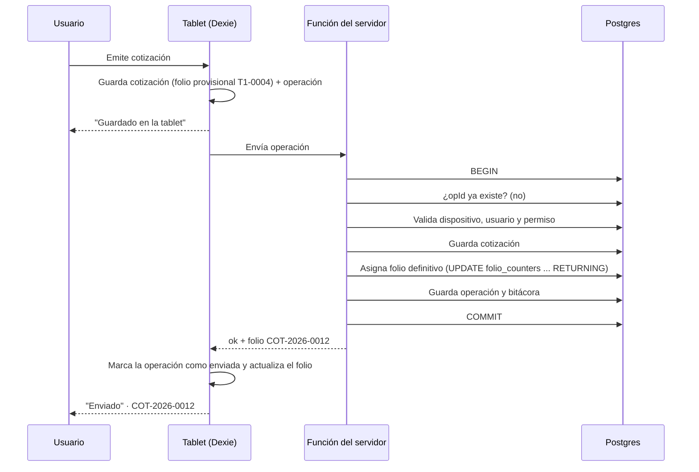
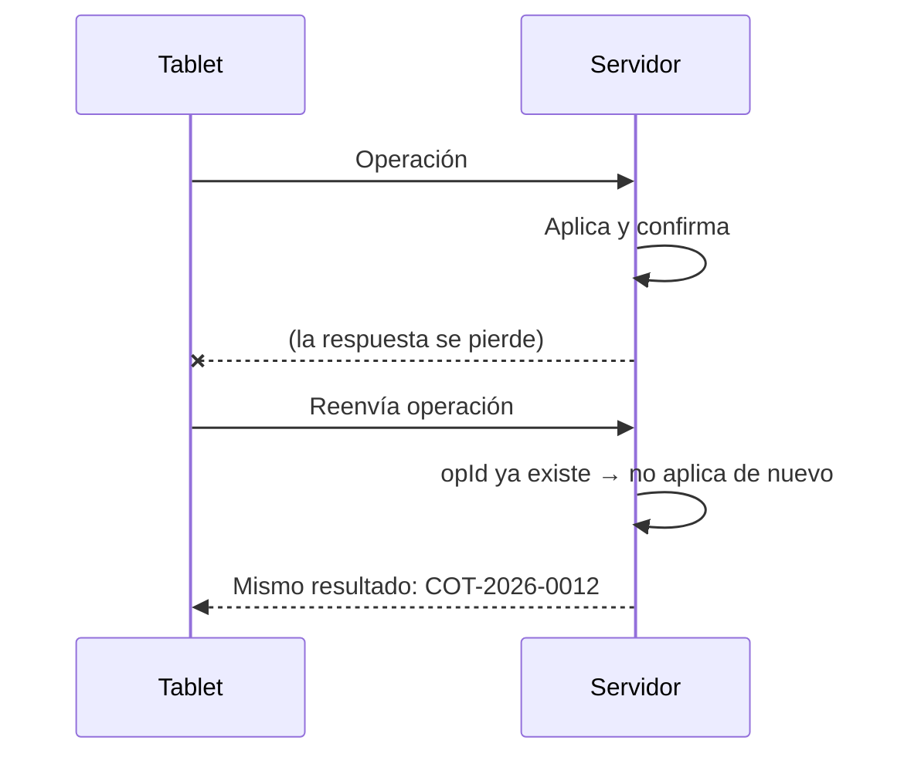

# Sincronización sin conexión y folios

> Borrador de Fase 2. Decisiones: [ADR-0012] (cola propia sobre Dexie), [ADR-0016] (operaciones y folios), [ADR-0015] (modelo). Reglas: [RN-15], [RN-16], [RN-18]. Principios: `docs/plan/00-principios-de-ingenieria.md` §6.
> Varias piezas se **validan con `spike/sync`** antes de cerrarse (sección 11). Lo que aquí es hipótesis dice "a validar".
> En la interfaz nunca aparecen "sincronizar" ni "offline" [GLOSARIO]: se dice "Guardado en la tablet" y "Enviado".

## 1. Principios

1. La tablet escribe primero en local (IndexedDB) y encola una **operación**.
2. Los identificadores se generan en la tablet (UUID). Un registro creado sin conexión ya tiene identidad.
3. Una operación se aplica **una sola vez** en el servidor (idempotencia por `opId`).
4. El folio definitivo lo asigna el servidor **dentro de la misma transacción** que guarda el documento.
5. Lo contable se **agrega**: pagos, ventas y cambios de estado son eventos; no se sobrescriben.
6. Lo que requiere servidor (facturar, reportes consolidados, administración de usuarios y dispositivos) se dice claramente en la interfaz.

## 2. Qué vive dónde

| Datos | En la tablet | Dirección | Quién escribe |
|---|---|---|---|
| Catálogo, categorías, reglas de precio | Sí | Servidor → tablet | Solo administradores, en línea |
| Configuración del negocio e interruptores P1/P2 | Sí | Servidor → tablet | Administradores, en línea |
| Usuarios activos y verificadores de PIN | Sí | Servidor → tablet | Administradores, en línea [ADR-0013] |
| Aviso de privacidad y términos (versión vigente) | Sí | Servidor → tablet | Administradores, en línea |
| Clientes y domicilios | Sí | Ambos | Tablet y administrador |
| Cotizaciones | Sí (ventana de retención) | Ambos | Tablet |
| Órdenes de trabajo abiertas y recientes, sus pagos y estados | Sí (ventana de retención) | Ambos | Tablet |
| Ventas de mostrador, pagos, turnos y cortes de caja | Sí (los propios y recientes) | Ambos | Tablet |
| Garantías | Sí | Ambos | Tablet (al entregar) |
| Folios definitivos | Sí (se reciben) | Servidor → tablet | Servidor |
| Facturas (CFDI) | No | Solo servidor | Servidor ⚠ PD-01 |
| Bitácora completa, reportes consolidados, dispositivos | No | Solo servidor | Servidor |
| Historial anterior a la ventana de retención | No | Solo servidor | — |
| Existencias (P2) | Sí, si P2 está activo | Ambos | Tablet |

La **ventana de retención** (cuánto historial baja a la tablet) es configurable; su valor se fija en Fase 3 con Luis. Las tablets de ZAMMIR son dos y una sola caja a la vez [ALCANCE], por lo que el volumen es pequeño.

## 3. La operación

Todo cambio sale de la tablet como una **operación** con este sobre:

| Campo | Contenido |
|---|---|
| `opId` | UUID generado en la tablet. Es la llave de idempotencia |
| `deviceId`, `seq` | Dispositivo y número consecutivo propio (1, 2, 3…) para ordenar |
| `type` | `IssueQuote`, `RegisterPayment`, `AdvanceWorkOrder`, `CloseCashShift`… (los casos de uso) |
| `schemaVersion` | Versión del formato del `payload` |
| `userId`, `authorizedBy?` | Quién operó y, si aplica, el administrador que autorizó [ADR-0013] |
| `clientCreatedAt` | Hora de la tablet, en UTC |
| `payload` | Datos validados con Zod, con importes ya calculados por el dominio |

El servidor guarda cada operación en la tabla `operations` y su resultado (folio asignado, estado). La misma operación recibida dos veces devuelve el **mismo resultado guardado** y no repite nada.

## 4. Flujo de envío



- **Orden:** la tablet envía en orden de `seq`, de una en una (o en lotes pequeños en orden) y espera la confirmación. Si el servidor recibe `seq = n+1` sin haber procesado `n`, responde "fuera de orden" y la tablet reenvía desde la última confirmada.
- **Respuesta perdida:** si la conexión se corta después del `COMMIT` y la tablet no recibe la respuesta, reenvía la misma operación; el servidor responde con el resultado guardado (ver 4.1).

### 4.1 Reenvío tras una respuesta perdida



### 4.2 Reintentos
- Errores de red y 5xx: se reintenta con espera creciente (con variación aleatoria) mientras haya operaciones sin enviar. No hay límite de intentos; sí hay un aviso visible si algo lleva demasiado sin salir (umbral configurable).
- Errores **estructurales** (formato que el servidor no entiende, dispositivo revocado, tipo de operación desconocido): la operación pasa a `failed`, la cola de ese dispositivo se **detiene** y se muestra un aviso para llamar a soporte. No se descarta nada. Este es el caso raro que se vigila con la bitácora.
- Reglas de negocio **nunca** rechazan un hecho contable ya ocurrido (ver 6).

## 5. Folios

### 5.1 Provisional (en la tablet)
- Cada dispositivo tiene una serie `T<n>` asignada al registrarse (`T1`, `T2`). La tablet lleva un contador local; el folio provisional es `T1-0004`.
- La serie es **una sola por dispositivo**, compartida por todos los tipos de documento. El tipo se muestra junto al folio ("Cotización T1-0004").
- Los borradores no llevan folio; lo reciben al **emitirse** (enviar la cotización, abrir la orden, cobrar la venta).

### 5.2 Definitivo (en el servidor) [RN-15, RN-16]
Formatos: `COT-AAAA-0001`, `OT-AAAA-0001`, `V-AAAA-0001`; la factura `F-AAAA-0001` se asigna solo en servidor, en línea.

Tabla `folio_counters (doc_type, year, last_value)`. En la transacción de la operación, y como **último paso** para mantener el bloqueo breve:

```sql
INSERT INTO folio_counters (doc_type, year, last_value) VALUES ($1, $2, 0)
  ON CONFLICT (doc_type, year) DO NOTHING;
UPDATE folio_counters SET last_value = last_value + 1
  WHERE doc_type = $1 AND year = $2 RETURNING last_value;
```

- El `UPDATE` bloquea la fila: dos transacciones simultáneas **se turnan**, nunca obtienen el mismo número.
- Si la transacción falla, el incremento se revierte con ella: **no quedan huecos**.
- Un documento cancelado **conserva su folio** y queda como cancelado; los folios no se reutilizan.
- Una operación rechazada o que nunca llega no consume folio.

### 5.3 Consecuencias que conviene saber
- El folio definitivo sigue el **orden de llegada al servidor**, no el de creación. Una cotización hecha el martes sin conexión y enviada el viernes recibe un número mayor que otras hechas el miércoles.
- Un comprobante impreso sin conexión lleva el folio provisional y un **código público** (identificador corto y aleatorio, generado en la tablet con el documento) que el servidor reconoce después [RN-16]. Si el cliente intenta autofacturar antes de que el documento llegue al servidor, el portal dice que aún no está disponible (⚠ M10).
- **Año del folio (PD-23):** [RN-15] dice "año real en curso". Propongo el año de la fecha de **emisión** en hora de México, no el de envío. Queda pendiente de que Juanito o Luis lo confirmen; mientras tanto se construye así.

## 6. Conflictos: política por tipo de dato

| Tipo | Ejemplos | Política |
|---|---|---|
| Hechos contables que se agregan | Pagos, ventas, cotización emitida, garantía | Siempre se aceptan; no hay nada que sobrescribir |
| Cambios de estado | Avanzar una orden, cancelarla, entregar | Se validan con la máquina de estados contra el estado actual del servidor. Si la transición ya no es válida (ej.: otra tablet la canceló), la operación **se aplica como "por revisar"** con el motivo y un administrador la resuelve. No se pierde ni se rechaza |
| Pagos sobre una orden cancelada | Un anticipo cobrado en la tablet 2 después de cancelarse en la 1 | El pago se acepta (el dinero se recibió) y queda "por revisar" (⚠ PD-07, PD-24) |
| Datos editables | Clientes | Por campo, gana el último que **llega al servidor**; el valor anterior queda en la bitácora [RN-19] |
| Datos de referencia | Catálogo, reglas, configuración, usuarios | Solo se editan en línea por administradores; la tablet no los modifica |
| Precio cotizado distinto al actual | Cotización hecha con catálogo viejo | Se acepta: el precio queda congelado [RN-03]. El servidor guarda la versión del catálogo usada y marca la diferencia como informativa |
| Operaciones de usuario inactivo o dispositivo revocado | Operación hecha antes de que se enterara | Se aplica y queda "por revisar"; las posteriores al corte de acceso se rechazan de forma estructural [ADR-0013] |

**Alcance de esta tabla y [RNF-05]:** la regla "gana el último cambio por campo, con bitácora" aplica a los datos *editables* de una orden (responsables, fecha estimada, notas), igual que a los clientes. El **estatus** de una orden no es un campo editable: es una transición de la máquina de estados y sigue la fila "Cambios de estado". (Aclaración confirmada por Juanito el 2026-10-27. La ampliación completa del punto 8 de `docs/plan/fase-02-arquitectura.md` §2.8 queda para la Fase 2.)

**"Por revisar"** es un estado visible para administradores con el motivo. Nada se descarta automáticamente [RN-18].

### 6.1 Turno y corte de caja
Solo hay una caja abierta a la vez. El corte nivel 1 se calcula en la tablet con lo que tiene y avisa si quedan operaciones sin enviar. El servidor lo recalcula al recibirlo; si difiere, lo marca "por revisar". Reabrir lo hace solo un administrador, con rastro [RF-M4-06].

## 7. Descarga de datos de referencia y de documentos

- Cada tabla replicada tiene una columna `change_seq` (secuencia global que sube con cada cambio). La tablet guarda el último valor visto por tabla.
- Para ponerse al día pide "todo lo mayor a este número", por páginas. Como nada se borra [RN-18] (solo se desactiva), no hacen falta registros de borrado.
- Los documentos propios regresan en la descarga con su folio definitivo; la tablet los reconcilia por `id`.
- La **primera carga** de una tablet nueva baja todo en un solo proceso reanudable.
- Los datos que llegan **no pisan** cambios locales pendientes: la tablet toma la versión del servidor y vuelve a aplicar encima las operaciones aún no enviadas.

## 8. Estado visible para el usuario

| Situación | Texto en pantalla |
|---|---|
| Documento con operaciones sin enviar | "Guardado en la tablet" |
| Todo confirmado | "Enviado" |
| Sin conexión | "Sin conexión. Puedes seguir trabajando." + cuántos documentos faltan por enviar |
| Mucho tiempo sin enviar | "Hay documentos sin enviar desde hace X horas. Conéctate a internet." |
| Operación estructuralmente fallida | "Hay un problema con un documento. Avisa a soporte." |
| Acción que exige conexión | "Para hacer esto necesitas internet" |

El folio provisional se muestra como "Folio provisional T1-0004" y, al enviarse, el definitivo.

## 9. Almacenamiento local

- Tablas de Dexie: datos replicados, `outbox` (operaciones por enviar), `meta` (cursores, datos del dispositivo, contador de folio provisional).
- Se pide **almacenamiento persistente** del navegador para evitar que Android lo borre bajo presión de espacio; se verifica en la tablet real. Si no se concede, se avisa y se acorta el tiempo máximo tolerado sin enviar.
- Fotos de medición (RF-M3-01): son archivos grandes y opcionales; se encolan aparte y su subida no bloquea la operación de la orden. Pendiente de detallar en el Sprint 3.

## 10. Versionado y reloj

- **Versión del formato:** una actualización de la aplicación puede dejar en la cola operaciones con un formato anterior. El servidor acepta la versión actual y la anterior; las más viejas se migran con funciones de `packages/core`. La aplicación no borra operaciones al actualizarse.
- **Reloj:** `clientCreatedAt` se guarda tal cual; el servidor guarda además `received_at`. Una diferencia grande entre ambos se señala en bitácora. Días, semanas y cortes se calculan en hora de México [RN-17].

## 11. Validación obligatoria: `spike/sync`

Antes de cerrar [ADR-0012] y [ADR-0016], una validación corta y desechable demuestra, con Supabase local y dos tablets simuladas:

1. 200 operaciones desde dos dispositivos al mismo tiempo producen folios definitivos del 1 al 200, **sin huecos ni repetidos**.
2. Cortar la conexión a la mitad de una operación, por azar y muchas veces, no deja huecos, duplicados ni documentos a medias.
3. Reenviar cada operación 2 o 3 veces deja un solo registro por `opId`.
4. Una tablet sin conexión por horas se pone al día en orden y sin pérdida.
5. La función del servidor corre `packages/core` (Deno) con una conexión directa a Postgres y una transacción real. *(A validar: si no es viable, se mueve esa parte a una función SQL y se actualiza el ADR-0016.)*
6. Una operación fuera de orden se detecta y se corrige con reenvío.

Si falla el 1, 2 o 5, se reevalúa antes de continuar.

## 12. Pruebas obligatorias

- Contrato de `SyncOutbox` (memoria, IndexedDB) y del receptor de operaciones.
- Propiedades: "para cualquier secuencia de envíos, reintentos y duplicados, hay un solo efecto por `opId` y los folios de cada tipo y año son 1..N sin huecos".
- Concurrencia en Postgres con dos o más clientes.
- Escenarios: horas sin conexión; corte a mitad de envío; duplicados; fuera de orden; dispositivo revocado; usuario desactivado; versión vieja de formato; reloj desfasado; edición simultánea de un cliente; pago sobre orden cancelada; cancelación simultánea.

## 13. Riesgos
- **Cola detenida por una operación estructuralmente mala:** rara, pero bloquea. Se mitiga con validación Zod antes de encolar y con pruebas de contrato del formato.
- **Pérdida de datos locales** si el navegador los borra antes de enviar: persistencia, avisos de antigüedad y envío rápido al haber conexión.
- **Bloqueo de la fila de folios:** a este volumen no es problema; el folio se asigna al final de la transacción.
- **PD-01 (§7 y §8):** puede cambiar el flujo de facturación y de impresión; no el de operaciones y folios.
