# Manual de usuario (borrador)

> Historia S4-29. Para quien trabaja en ZAMMIR: cajeros / vendedores y administradores. Explica el día a día con las palabras del oficio y capturas de pantalla.
> **Todas las capturas usan datos inventados** (personas, clientes, productos y precios de prueba). Se generan con `pnpm manual:capturas` cada vez que cambia la interfaz, para que el manual no se quede viejo.
> Es un **borrador**: se revisa con Luis y con el equipo en las capacitaciones (Sprint 5). Lo que todavía no está resuelto lo marca **(pendiente)**.

## Antes de empezar

- **ZAMMIR funciona sin internet.** Puedes cotizar y cobrar aunque no haya señal: todo se guarda en la tablet y **sale solo cuando vuelve la conexión**. Un cobro o una cotización que dice *"Guardada en la tablet"* no se pierde.
- **Dos tipos de persona:**
  - **Cajero / vendedor:** cotiza, vende en el mostrador, cobra y avanza los trabajos.
  - **Administrador** (Luis, Ricardo): además da descuentos, autoriza excepciones, ve los reportes, factura y administra personas, tablets y catálogo.
- **Dos formas de entrar:**
  - En la **tablet**, con tu **nombre y tu PIN**.
  - En la **computadora**, solo los administradores, con **correo y contraseña**, para las secciones de administración (Usuarios, Clientes, Catálogo, Configuración y Facturas).
- **Cada quien usa su PIN.** Nunca compartas tu PIN: lo que hagas queda anotado con tu nombre.
- **Los precios ya incluyen IVA.**

---

## 1. Conectar la tablet y entrar con tu PIN

### Conectar una tablet nueva (lo hace un administrador, una sola vez)

1. En la computadora, un administrador entra a **Usuarios** y toca **Generar código**. El código sirve **una sola vez** y vence en pocos minutos.

   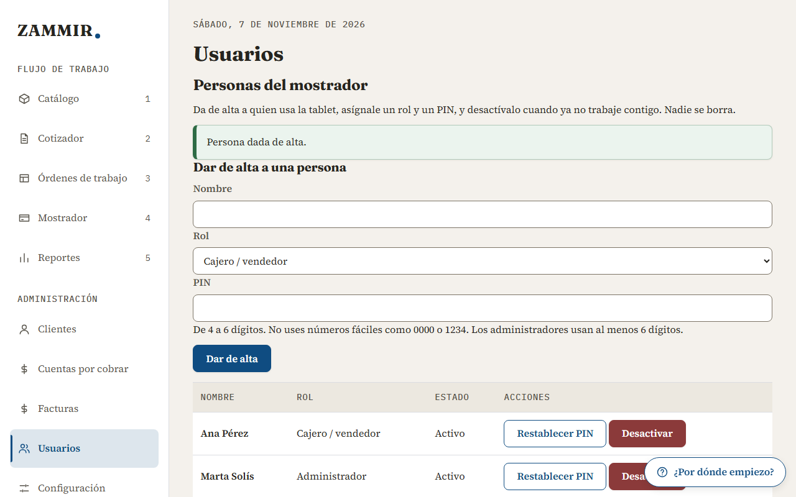

2. En la tablet abre **Conectar esta tablet**, escribe el código y un nombre para la tablet (por ejemplo, *Mostrador*) y toca **Conectar**.

   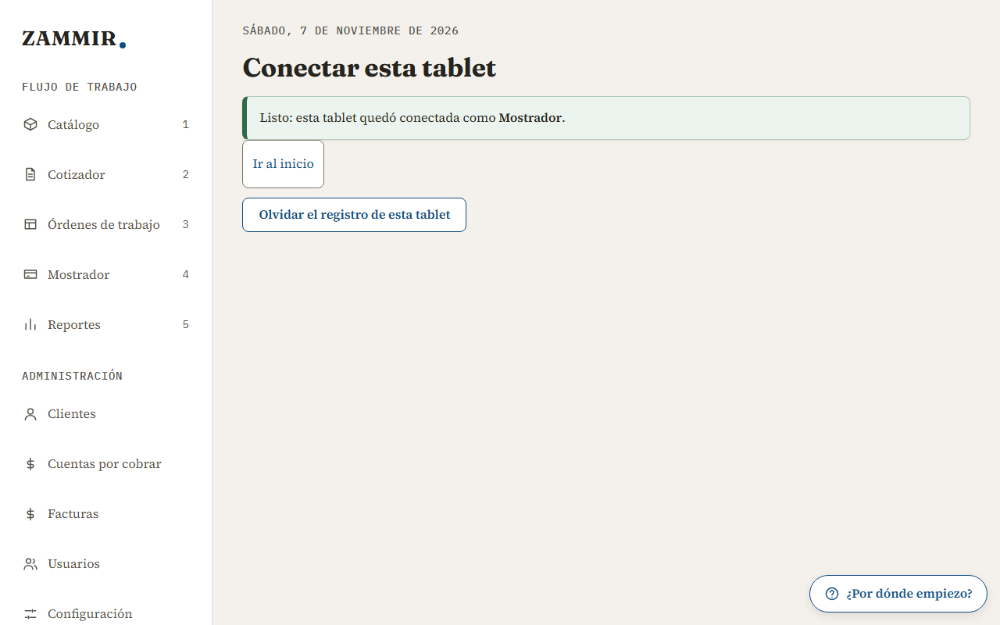

3. La primera vez la tablet necesita **internet unos momentos** para recibir el catálogo, las personas y la configuración. Si al abrir el Cotizador dice que todavía no puede cotizar, conéctala a internet y vuelve a abrir la aplicación.

### Entrar con tu PIN (todos los días)

1. Toca **Entrar con PIN**. Aparece la lista de personas.
2. Toca **tu nombre** y escribe tu **PIN** en el teclado. Toca **Entrar**.

   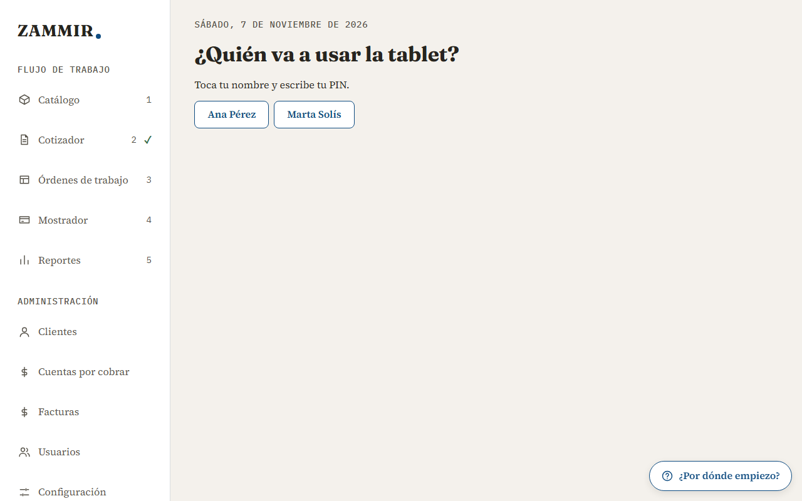

3. Llegas al **Panel de inicio**. Arriba verás *"Está usando la tablet: tu nombre"*.

   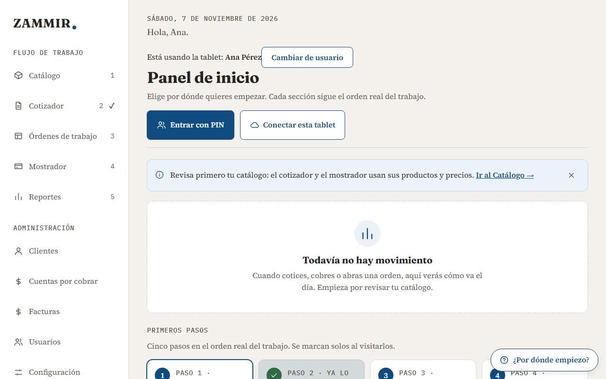

- **Cambiar de persona:** toca **Cambiar de usuario**. Lo que estabas haciendo no se pierde.
- **Si no usas la tablet un rato**, se bloquea sola y tienes que volver a poner tu PIN.
- **Si olvidaste tu PIN o te equivocas varias veces:** pide a un administrador que lo restablezca. Si te equivocas muchas veces seguidas, la tablet te hace esperar un momento antes de intentar otra vez.

---

## 2. Cotizar

El **Cotizador** sirve para armar el presupuesto con el cliente, incluso en la obra y sin internet.

1. Entra a **Cotizador** y toca **Nueva cotización**.

   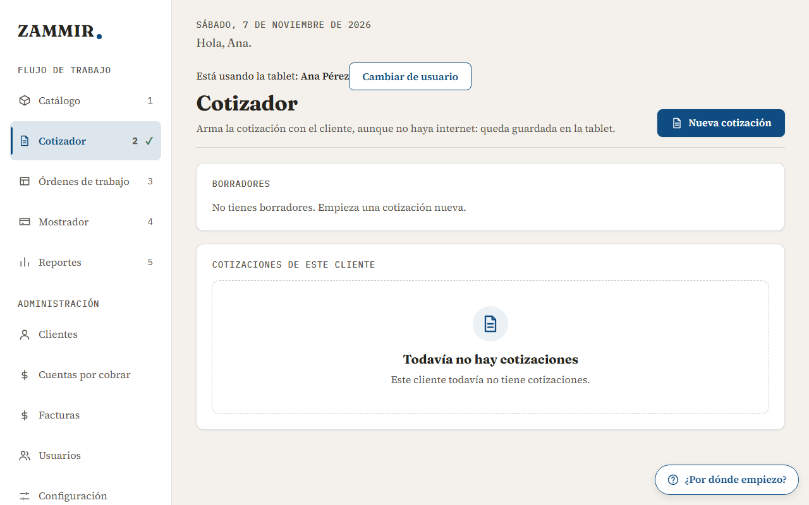

2. **Elige o captura al cliente.** Busca por nombre o WhatsApp; si es nuevo toca **Cliente nuevo** y escribe su nombre y su WhatsApp de 10 dígitos (el domicilio de la obra es opcional). Si ya existe alguien con ese WhatsApp, el sistema te avisa.
3. **Agrega productos.** Escribe el nombre en *Buscar producto o servicio* y tócalo:
   - **A medida** (cristales, espejos): escribe **ancho**, **alto** y **cantidad**, y elige si las medidas son en **centímetros** o **metros**. El sistema calcula el importe y aclara cuando sube las medidas al múltiplo que se cobra (por ejemplo, *"medidas subidas a múltiplos de 50 mm"*).
   - **Piezas y servicios:** se agregan con una cantidad.
4. Revisa los **Conceptos**, el **Subtotal**, el **IVA** y el **Total**. A la derecha ves la **vista previa del documento** tal como lo recibirá el cliente.

   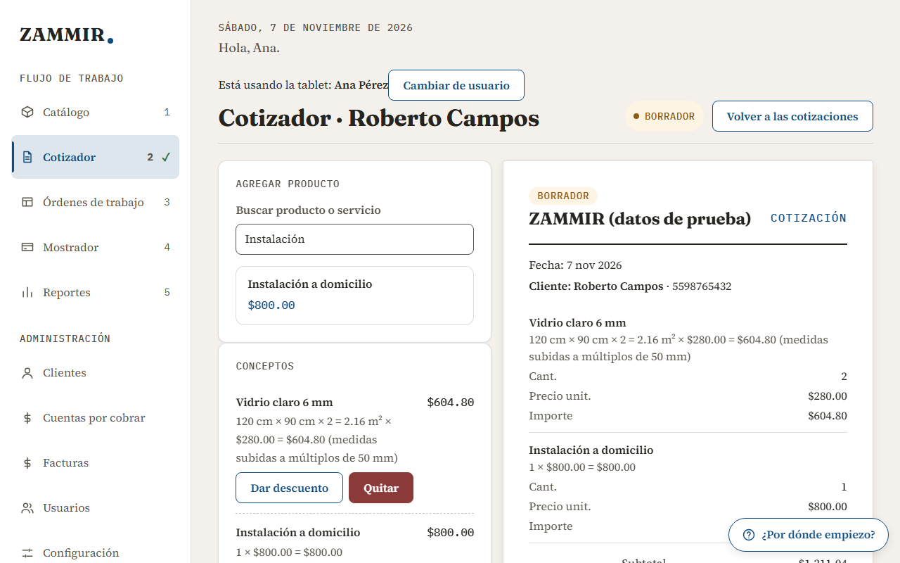

5. Toca **Emitir cotización**. Queda con un **folio provisional** (algo como `T1-0001`), un **código** y una fecha de **vigencia**. Una vez emitida **ya no se puede cambiar**: si necesitas otra versión, toca **Duplicar**.

   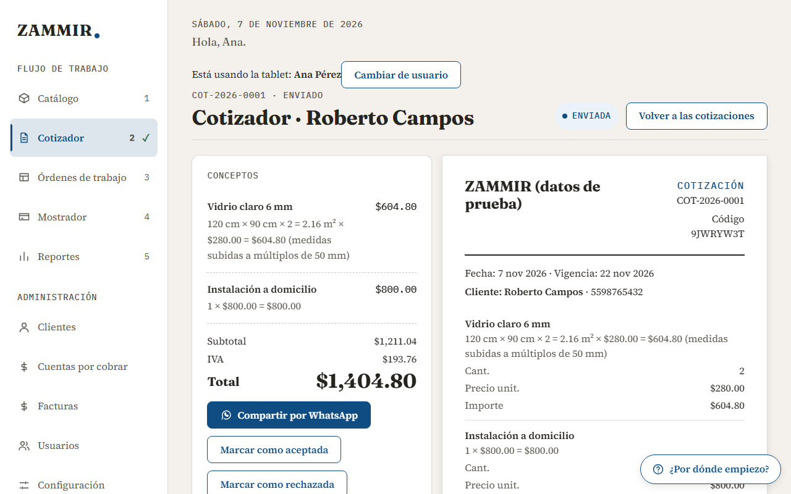

6. **Compártela** con **Compartir por WhatsApp**: se prepara el PDF y eliges WhatsApp en el menú. Si tu tablet no tiene menú de compartir, se descarga el PDF y se abre WhatsApp con el mensaje.
7. Cuando el cliente responda, toca **Marcar como aceptada** o **Marcar como rechazada**.

**Descuentos.** **Dar descuento** pide el **PIN de un administrador**. El nuevo precio nunca puede ser mayor que el del catálogo ni negativo.

**Estados de una cotización:** Borrador, Enviada, Aceptada, Rechazada y Vencida. Las cotizaciones de cada cliente se ven en su historial.

> **Folio provisional y definitivo.** Mientras la tablet no ha enviado el documento, su folio es provisional (`T1-…`). Al enviarlo, el servidor le pone el folio definitivo. Sin internet no hay problema: nada se duplica.

---

## 3. Vender en el mostrador

El **Mostrador** es para ventas inmediatas (piezas, servicios y vidrio a medida) y para cobrar al momento. **Necesitas un turno de caja abierto** para cobrar.

### Abrir tu turno

1. Entra a **Mostrador**. En *Mi turno de caja* escribe tu **fondo inicial** (el efectivo con que abres el cajón; es opcional) y toca **Abrir turno**.

   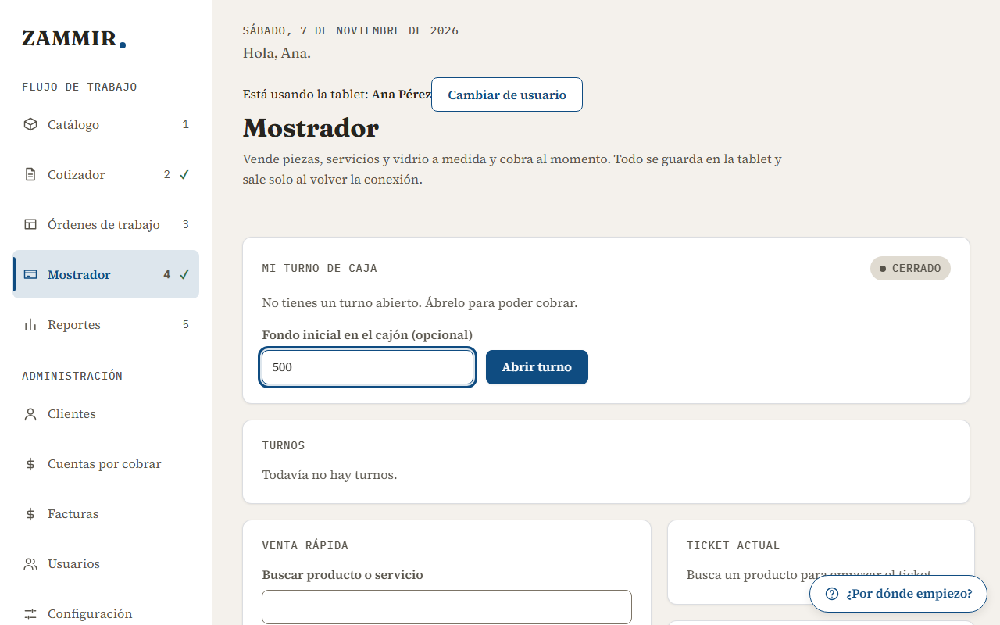

### Hacer una venta

1. En *Venta rápida* busca el producto. Una **pieza estándar** se agrega al **Ticket actual** con solo tocarla; lo que va **a medida** pide ancho, alto y cantidad.
2. En el ticket puedes cambiar la cantidad (**Una más** / **Una menos**), **Quitar** un producto o **Vaciar el ticket**.

   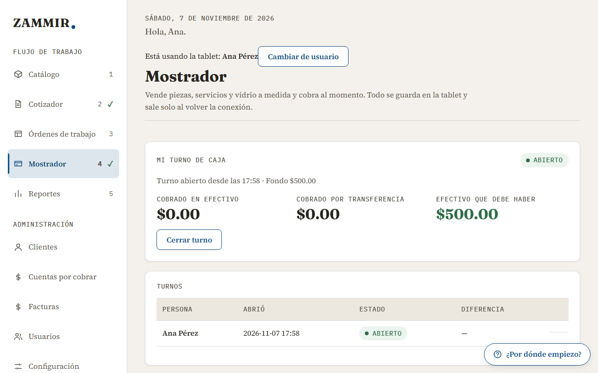

3. Toca **Cobrar**. Captura cómo paga el cliente:
   - **Efectivo recibido:** lo que te da. El sistema calcula el **cambio**.
   - **Efectivo que se aplica** y **Transferencia:** si paga **mixto**, reparte el total entre efectivo y transferencia (puedes anotar la **referencia** de la transferencia).

   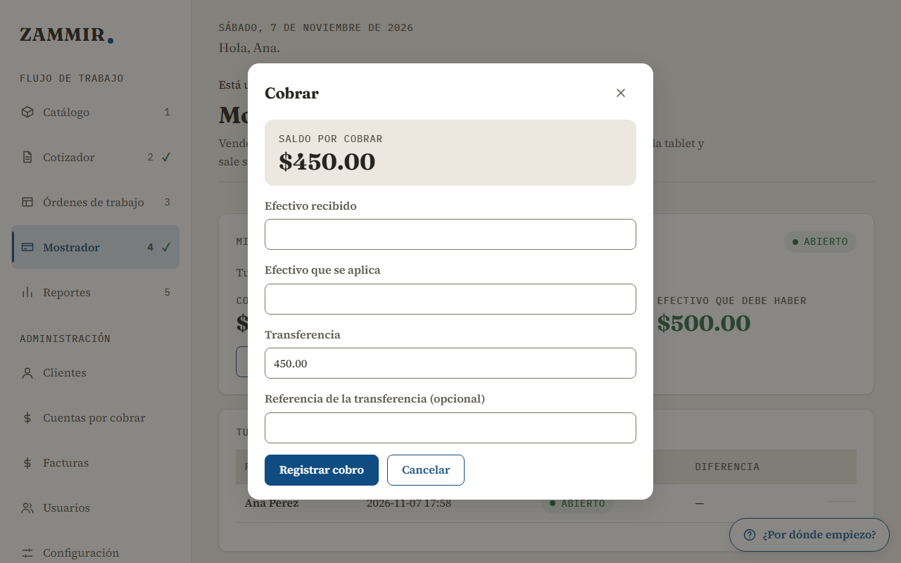

4. Toca **Registrar cobro**. Aparece **Venta registrada**, con su folio provisional, el **cambio** y la leyenda *"Guardada en la tablet"*. Toca **Imprimir ticket** (sale con su QR y su código de verificación).

   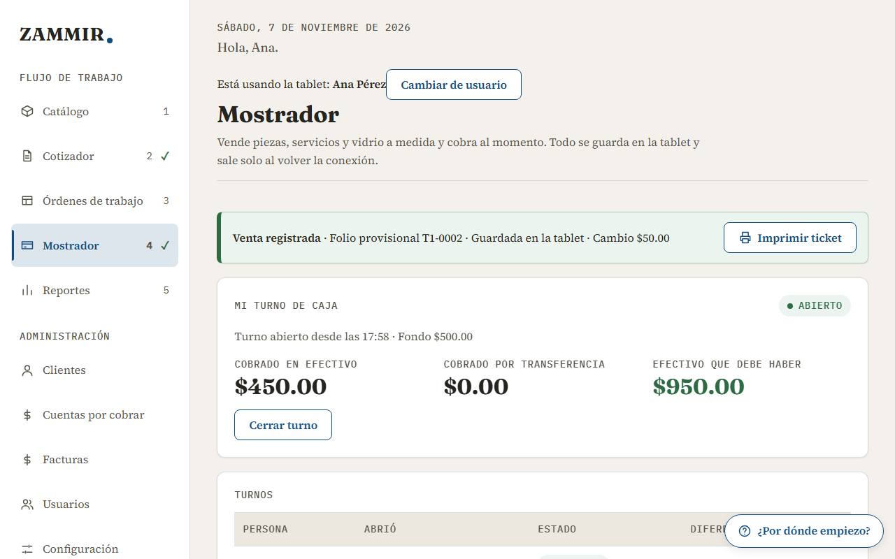

> Si te equivocas en una venta, **no se borra**: se cancela con motivo y queda el rastro.

---

## 4. Órdenes de trabajo

Una **orden de trabajo** es un trabajo aceptado que se fabrica o instala. Lleva su **anticipo**, su **saldo** y su **garantía**.

### Crear la orden

1. En **Órdenes de trabajo** verás las *Cotizaciones aceptadas por convertir*. Toca **Crear orden de trabajo** en la que sigue.

   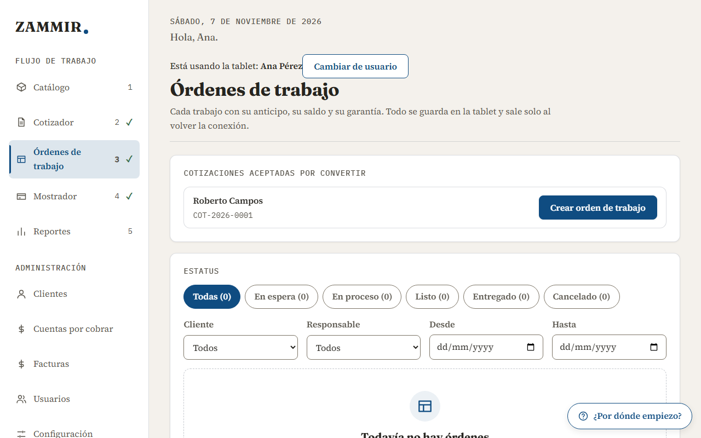

2. Se abre la orden, con su folio (por ejemplo `OT-2026-0001`), los conceptos y el recuadro **Cobro y saldo**: total, **anticipo exigido**, pagado y saldo.

   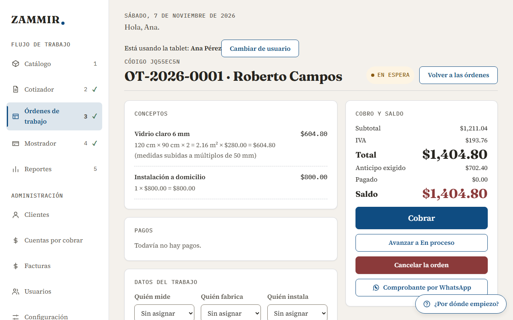

### Cobrar el anticipo

1. Toca **Cobrar**. El sistema te sugiere el **anticipo** (por defecto, la mitad).
2. Escribe el efectivo recibido y/o la transferencia, igual que en el mostrador. Toca **Registrar cobro**.

   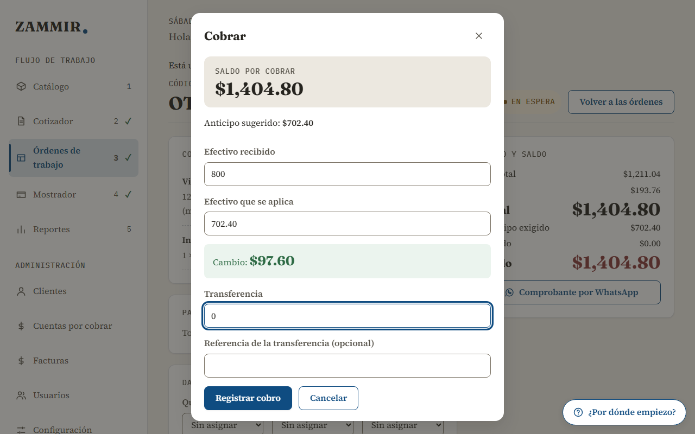

3. El pago aparece en la lista de **Pagos** y el saldo baja.

   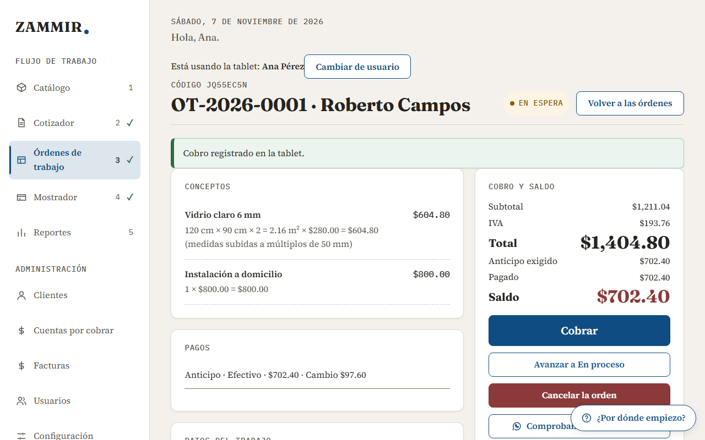

> **Para cobrar necesitas tu turno de caja abierto.** Si no, el sistema te dice *"Todavía no abres tu turno de caja"* y te lleva a abrirlo en el Mostrador.

### Seguir el trabajo

- En **Datos del trabajo** anota **quién mide**, **quién fabrica** y **quién instala**, y la **fecha estimada de entrega**. Toca **Guardar datos**.
- Avanza el estatus con **Avanzar a**: **En espera → En proceso → Listo → Entregado**.
- **Empezar sin anticipo** necesita el **PIN de un administrador**.
- **Entregar con saldo pendiente** necesita el **PIN de un administrador** y un **motivo**.
- **Cancelar la orden** necesita el **PIN de un administrador** y un **motivo**. Nada se borra.
- **Comprobante por WhatsApp:** un PDF con el folio, el saldo, la garantía y el **QR para que el cliente pida su factura**.

---

## 5. Cuentas por cobrar

**Cuentas por cobrar** lista las órdenes con saldo pendiente, **de la más atrasada a la más reciente**, y resalta las que llevan muchos días. Desde ahí toca **Registrar pago**. No es crédito: es el seguimiento de lo que falta por cobrar de trabajos ya en marcha.

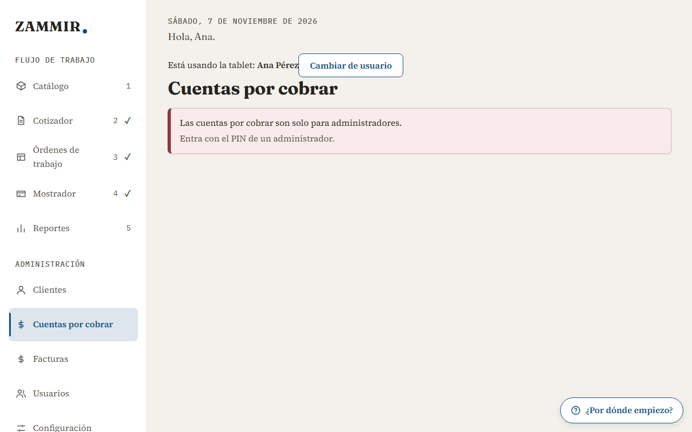

---

## 6. El corte de caja

Al terminar tu turno:

1. En **Mostrador**, en *Mi turno de caja*, revisa lo **cobrado en efectivo**, lo **cobrado por transferencia** y el **efectivo que debe haber**.
2. Toca **Cerrar turno**, cuenta el efectivo del cajón y escribe el **efectivo contado**.

   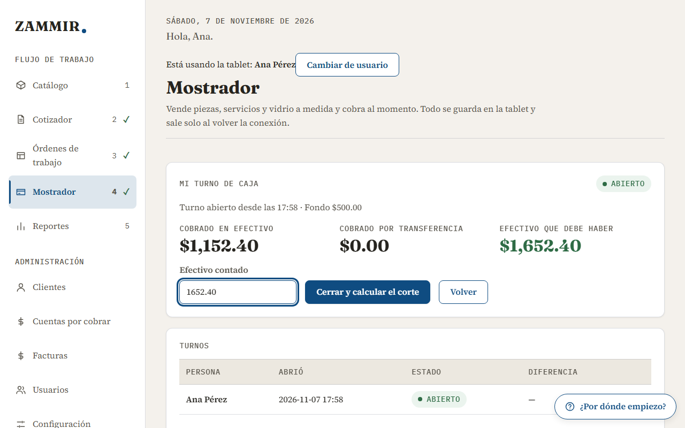

3. Toca **Cerrar y calcular el corte**. El sistema muestra el **efectivo esperado**, el **contado** y la **diferencia**: **Exacto**, **Sobrante** o **Faltante**. Toca **Imprimir resumen**.

   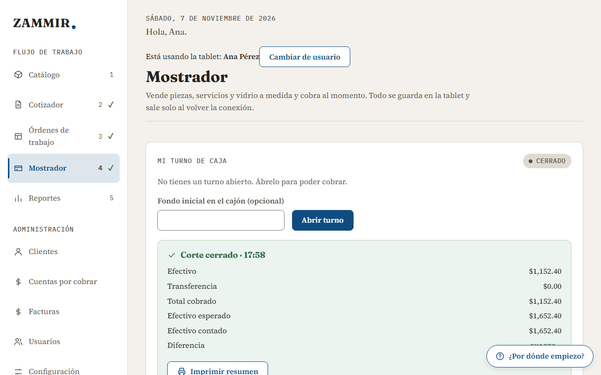

- Las **ventas canceladas no cuentan**.
- Cada cajero ve **solo su corte**; los administradores ven los de todos.
- Si hay operaciones **sin enviar**, el corte puede cambiar cuando lleguen al servidor; un administrador debe revisarlo.

---

## 7. Reportes (administradores)

Entra con el **PIN de un administrador**. En el Panel de inicio ves un resumen del día; en **Reportes**, las ventas de **hoy**, **esta semana** (de lunes a domingo) y **este mes**, siempre en hora de la Ciudad de México y comparadas con el periodo anterior, además de lo más vendido y los trabajos por estatus.

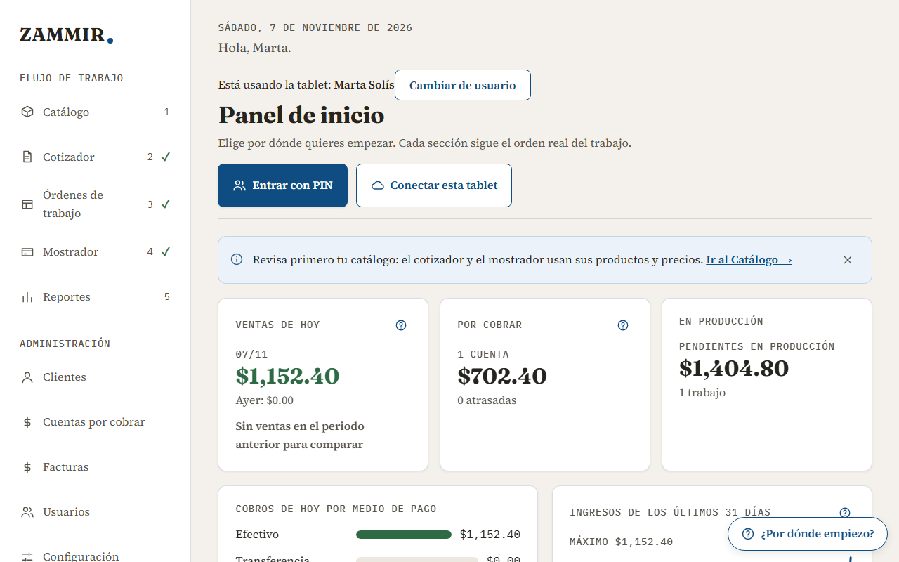

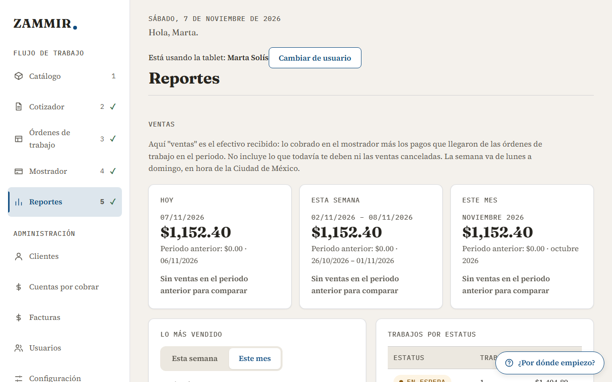

> En los reportes, **"ventas" es el efectivo y las transferencias recibidas**: lo cobrado en el mostrador más los pagos de las órdenes. No incluye lo que todavía te deben ni las ventas canceladas.

---

## 8. Administración en la computadora

Estas secciones son **solo para administradores**. Entra con tu **correo y contraseña**.

### Usuarios y tablets

Aquí das de alta a las personas del mostrador, les asignas **rol** y **PIN**, y registras las tablets.

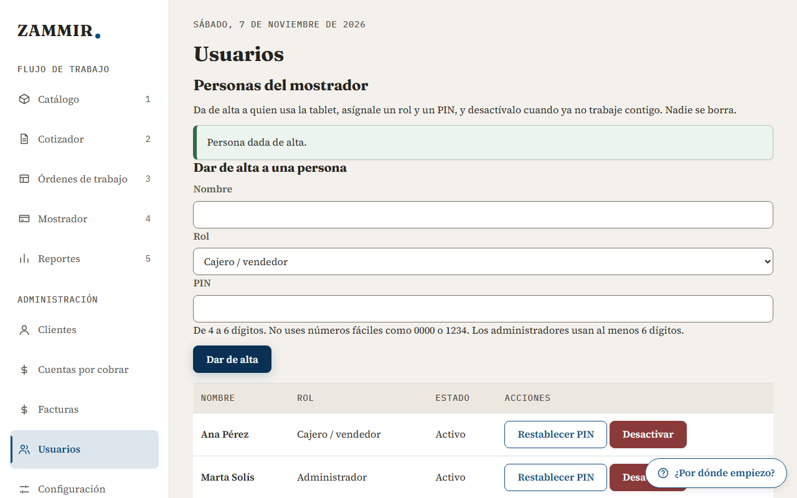

- **Dar de alta:** nombre, rol (*Administrador* o *Cajero / vendedor*) y PIN de 4 a 6 dígitos. **No uses números fáciles** como `0000` o `1234`.
- **Restablecer PIN**, **Desactivar** / **Activar**: nadie se borra; quien ya no trabaja se desactiva y su historial se conserva.
- **Bitácora:** quién hizo qué, desde qué tablet y cuándo. Solo se consulta.
- **Tablets:** **Generar código** para una nueva y **Revocar** las que ya no se usen (se conserva su registro).

### Clientes

La **ficha del cliente** reúne sus cotizaciones, órdenes, ventas, pagos, garantías y **facturas**, y marca si es **recurrente** (dos o más trabajos entregados).

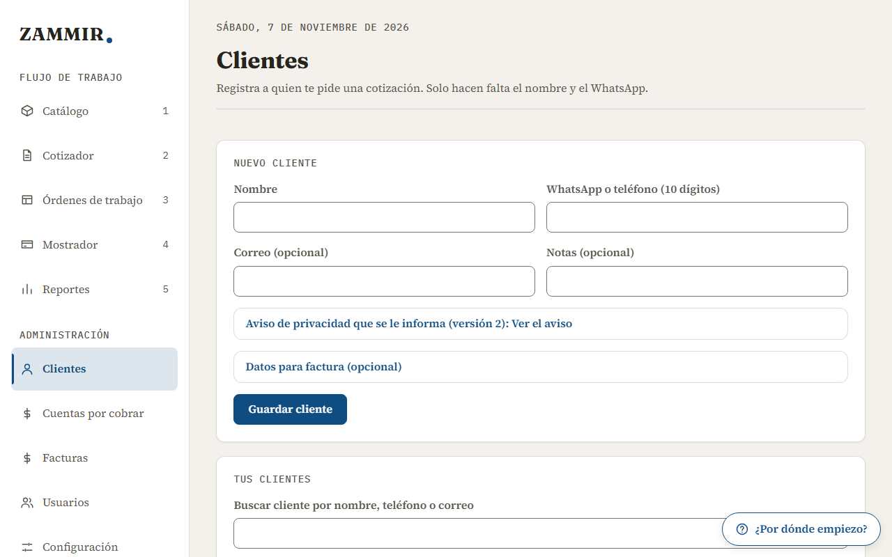

### Catálogo

Tus **productos y precios de lista, con IVA incluido**. Lo que cambies aquí se usa en el cotizador y en el mostrador. Puedes **Agregar producto**, **Editar**, **Desactivar** (nunca se borran) o **Importar desde archivo**.

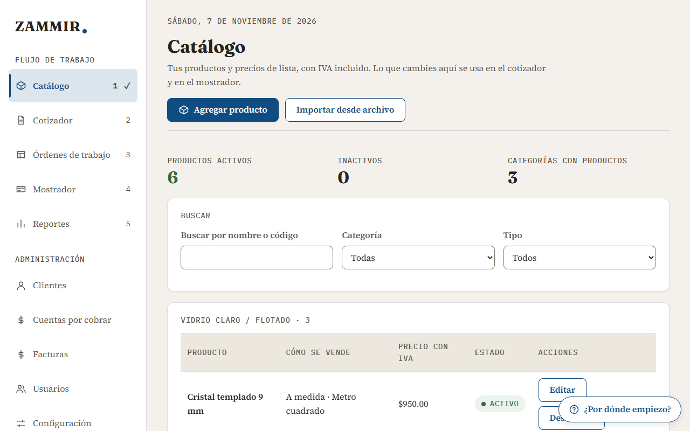

### Configuración

Aquí se edita el **aviso de privacidad** (cada cambio crea una versión nueva y las anteriores se conservan), los **términos del servicio** y las **condiciones de la cotización**. El texto del aviso es un **borrador** que debe revisar el asesor de ZAMMIR **(pendiente)**.

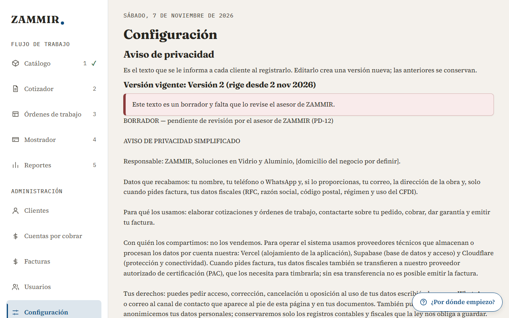

---

## 9. Facturas (administradores)

En **Facturas** hay dos pestañas: **Por facturar** y **Emitidas**. Arriba ves cuántas hay por facturar y los **timbres del año**.

> **Importante:** mientras no se conecte el proveedor de timbrado real y el certificado de ZAMMIR **(pendiente)**, las facturas son **de prueba y no tienen validez fiscal**.

### Facturar una venta u orden

1. En **Por facturar** aparecen las ventas y órdenes **ya liquidadas** que no tienen factura. Toca **Facturar**.

   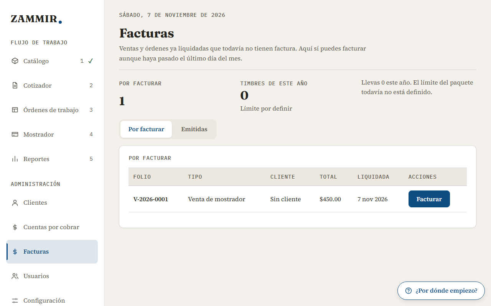

2. Revisa los datos del cliente: **RFC**, **nombre o razón social**, **código postal fiscal**, **régimen fiscal** y **uso de la factura**. Si el cliente ya tiene datos fiscales en su ficha, vienen precargados y los puedes corregir.
3. Si el cliente pagó **mixto**, el sistema te pide **elegir la forma de pago**.

   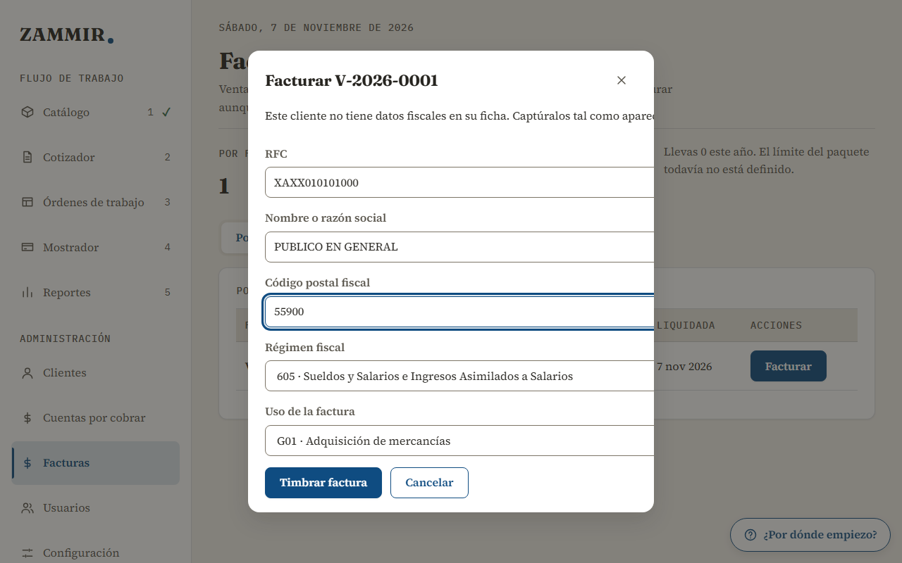

4. Toca **Timbrar factura**. Obtienes el folio (por ejemplo `F-2026-0001`) y puedes bajar el **PDF** y el **XML**, o **Enviar por WhatsApp**.

   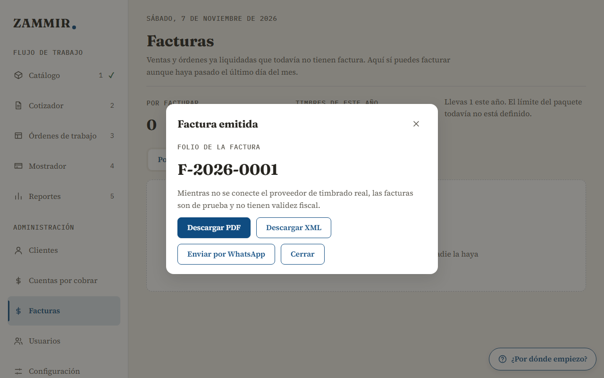

- Aquí **sí puedes facturar aunque haya pasado el último día del mes** (el cliente, en el portal, no).
- Una venta **ya facturada** no se puede facturar otra vez.

### Revisar, descargar y cancelar

En **Emitidas** ves cada factura con su estado: **Vigente**, **Cancelada**, **En proceso** (el proveedor de timbrado no contestó; se reintenta y **nunca se timbra dos veces**; puedes tocar **Reintentar**) o **Rechazada**.

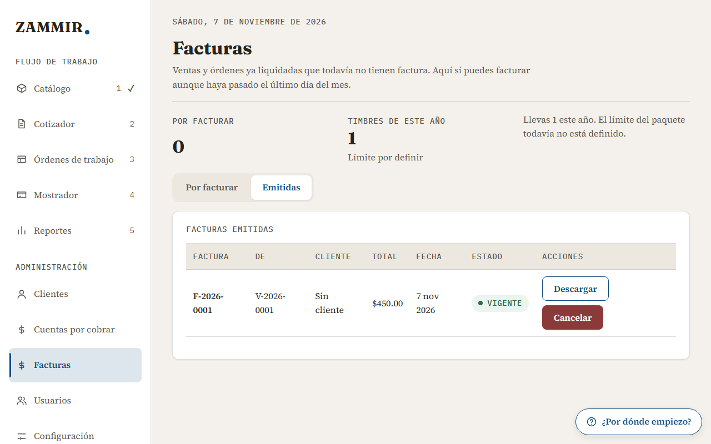

**Cancelar** una factura mal emitida (por ejemplo, un RFC equivocado): toca **Cancelar**, elige el **motivo** del SAT (si es el 01, escribe el folio de la factura que la sustituye) y confirma. **Nada se borra**: la factura queda marcada como cancelada, con el motivo y quién la canceló. Después puedes volver a facturar la venta u orden.

---

## 10. Cuando el cliente pide su factura

Cada **ticket** y cada **comprobante de trabajo** trae un **QR**. El cliente lo escanea con su teléfono y llega al portal **Pide tu factura**, sin cuenta ni contraseña.

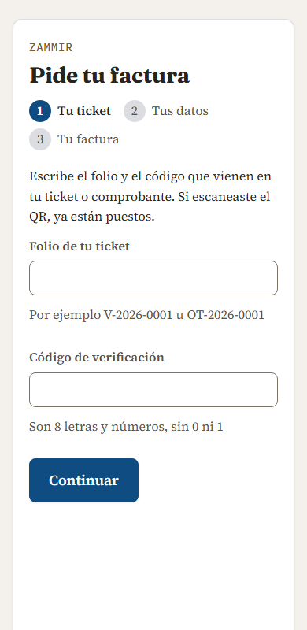

1. Escribe el **folio** y el **código de verificación** (si escaneó el QR, ya están puestos).
2. Captura sus **datos fiscales** y recibe su factura.

El cliente puede pedirla **hasta el último día del mes** de su compra. Después, o si el portal no puede, un administrador la factura desde **Facturas**. Si el portal le dice que no encuentra su compra, puede ser que la tablet todavía no la haya enviado: conéctala a internet.

---

## 11. Cuando algo no sale como esperas

| Qué ves | Qué hacer |
|---|---|
| *"Esta tablet todavía no puede cotizar…"* | Conéctala a internet unos minutos y vuelve a abrir la aplicación. |
| *"El PIN no es correcto"* | Revísalo y vuelve a intentar. Si lo olvidaste, pide a un administrador que lo restablezca. |
| *"Todavía no abres tu turno de caja"* | Ve al **Mostrador** y toca **Abrir turno**. |
| *"Falta la autorización de un administrador"* | Pide a un administrador que teclee su PIN. |
| *"Esta cotización ya se emitió y no se puede cambiar"* | Toca **Duplicar** y haz una nueva. |
| *"Guardada en la tablet"* | Está bien guardado; saldrá solo cuando haya internet. |
| *"Hay N operaciones sin enviar"* | Conecta la tablet a internet. No borres nada. |
| *"Esta pantalla tuvo un problema"* | Toca **Volver a abrir**. Lo que ya guardaste no se pierde. Avísale a Juanito. |

**Soporte:** por WhatsApp o correo, en horario hábil. Dile qué pantalla estabas usando, a qué hora y el folio (si lo hay). **Nunca** mandes por mensaje tu PIN ni tu contraseña.

---

## Palabras que usamos

| Palabra | Qué significa |
|---|---|
| **Anticipo** | El primer pago de un trabajo, por defecto la mitad, para empezar a fabricar. |
| **Saldo** | Lo que falta por pagar: el total menos lo pagado. |
| **Cotización** | El presupuesto formal con folio, vigencia y condiciones. |
| **Orden de trabajo** | Un trabajo aceptado que se fabrica o instala. |
| **Venta de mostrador** | Una venta inmediata, sin orden de trabajo. |
| **Corte de caja** | El cierre de tu turno: esperado, contado y diferencia. |
| **Folio provisional** | El número que lleva un documento mientras la tablet no lo ha enviado (`T1-0001`). |
| **Código de verificación** | El código del ticket o comprobante que el cliente usa, con el folio, para pedir su factura. |
| **Cliente recurrente** | Un cliente con dos o más trabajos entregados. |
