<!--
  Documento HMX-ZAM-04 del expediente de entrega [ADR-0047]. Historia S4-29.
  Las capturas usan solo datos inventados y se generan con `pnpm manual:capturas` cada vez que cambia la interfaz.
  Se repasa con Luis, Ricardo y el equipo en las capacitaciones; lo que cambie sale en la versión siguiente.
-->

# Manual de usuario · Sistema de gestión de ZAMMIR

*HMX-ZAM-04 · versión 1.0 · HummingX BI*

Este manual es para quien trabaja en ZAMMIR: cajeros / vendedores y administradores. Explica el día a día con las palabras del oficio. **Todas las capturas usan datos inventados.**

## Antes de empezar

- **ZAMMIR funciona sin internet.** Puedes cotizar y cobrar aunque no haya señal: todo se guarda en la tablet y **sale solo cuando vuelve la conexión**. Un cobro o una cotización que dice *"Guardada en la tablet"* no se pierde.
- **Dos tipos de persona:**
  - **Cajero / vendedor:** cotiza, vende en el mostrador, cobra y avanza los trabajos.
  - **Administrador** (Luis, Ricardo): además da descuentos, autoriza excepciones, ve los reportes y administra personas, tablets y catálogo.
- **Dos formas de entrar:**
  - En la **tablet**, con tu **nombre y tu PIN**.
  - En la **computadora**, solo los administradores, con **correo y contraseña**, para las secciones de administración (Usuarios, Clientes, Catálogo y Configuración). *Facturas* aparecerá cuando se reactive la facturación (ver el anexo al final).
- **Cada quien usa su PIN.** Nunca compartas tu PIN: lo que hagas queda anotado con tu nombre.
- **Los precios ya incluyen IVA.**

- **Recorrido guiado:** la primera vez que abres el sistema aparece un recorrido que te enseña cada parte de la pantalla. Para verlo otra vez, toca **Recorrido guiado** al pie de la barra de secciones. Usa **Siguiente**, **Anterior** o **Saltar el recorrido**.
- **¿Cómo se entra?** El panel de inicio explica las tres formas de entrar y el orden para dejar listo el sistema la primera vez.

---

## 1. Conectar la tablet y entrar con tu PIN

### Conectar una tablet nueva (lo hace un administrador, una sola vez)

1. En la computadora, un administrador entra a **Usuarios** y toca **Generar código**. El código sirve **una sola vez** y vence en pocos minutos.

   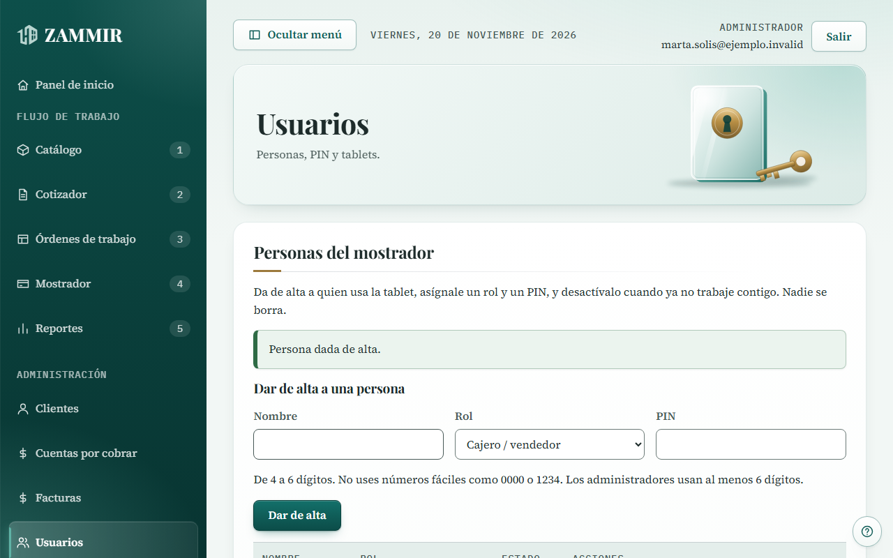

2. En la tablet abre **Conectar esta tablet**, escribe el código y un nombre para la tablet (por ejemplo, *Mostrador*) y toca **Conectar**.

   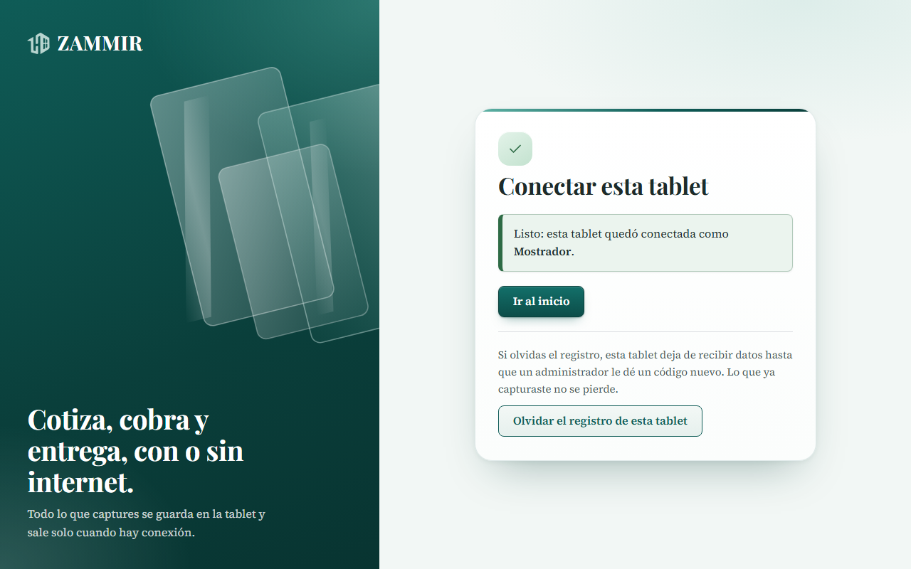

3. La primera vez la tablet necesita **internet unos momentos** para recibir el catálogo, las personas y la configuración. Si al abrir el Cotizador dice que la tablet todavía no tiene el catálogo ni la lista de personas, conéctala a internet y vuelve a abrir la aplicación.

### Entrar con tu PIN (todos los días)

1. Toca **Entrar con PIN**. Aparece la lista de personas.
2. Toca **tu nombre** y escribe tu **PIN** en el teclado. Toca **Entrar**.

   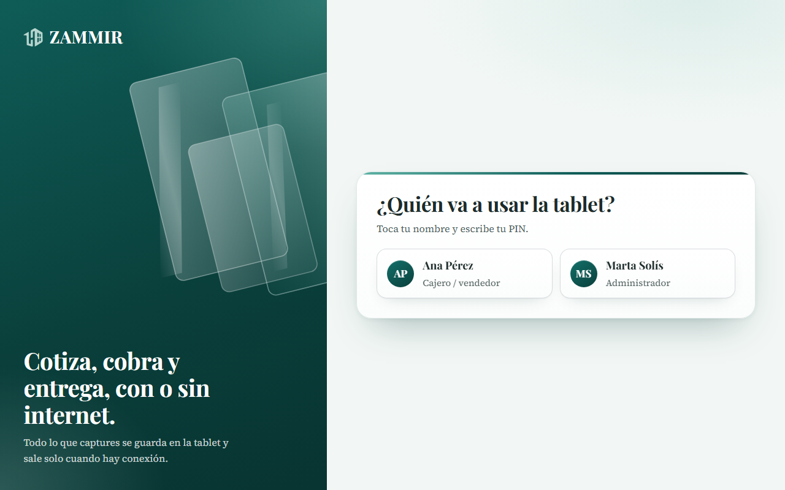

3. Llegas al **Panel de inicio**. Arriba verás *"Está usando la tablet: tu nombre"*.

   

- **Cambiar de persona:** toca **Cambiar de usuario**. Lo que estabas haciendo no se pierde.
- **Si no usas la tablet un rato**, se bloquea sola y tienes que volver a poner tu PIN.
- **Si olvidaste tu PIN o te equivocas varias veces:** pide a un administrador que lo restablezca. Si te equivocas muchas veces seguidas, la tablet te hace esperar un momento antes de intentar otra vez.

---

## 2. Cotizar

El **Cotizador** sirve para armar el presupuesto con el cliente, incluso en la obra y sin internet.

1. Entra a **Cotizador** y toca **Nueva cotización**.

   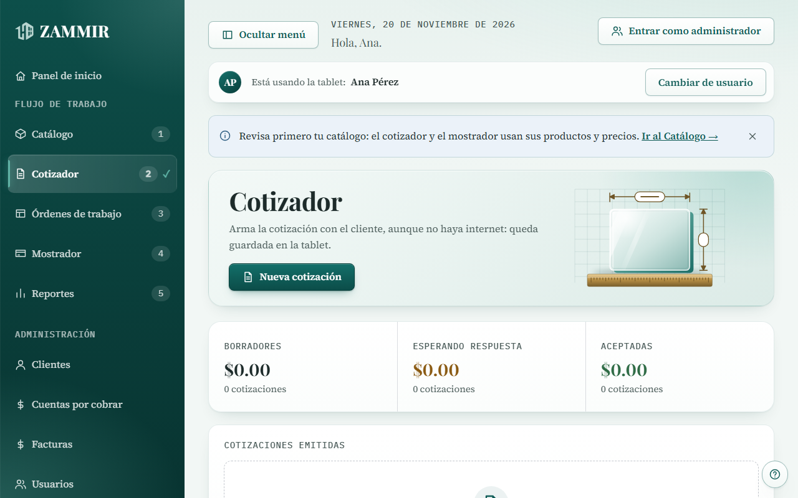

2. **Elige o captura al cliente.** Busca por nombre o WhatsApp; si es nuevo toca **Cliente nuevo** y escribe su nombre y su WhatsApp de 10 dígitos (el domicilio de la obra es opcional). Si ya existe alguien con ese WhatsApp, el sistema te avisa.
3. **Agrega productos.** Escribe el nombre en *Buscar producto o servicio* y tócalo:
   - **A medida** (cristales, espejos): escribe **ancho**, **alto** y **cantidad**, y elige si las medidas son en **centímetros** o **metros**. El sistema calcula el importe y, si el producto se cobra por múltiplos de medida, te aclara cuándo subió las medidas.
   - **Piezas y servicios:** se agregan con una cantidad. Si el producto dice su **unidad de venta**, la cantidad se lee así: *2 rollos*, *3 pares*. Lo que se vende **con decimales** (por ejemplo, vinil por kilo u horas de trabajo) acepta hasta 3: *1.5 kilos*, *2.5 horas*.
   - **Paquetes** (por ejemplo, *Cancel de baño*): agregan de una vez **un renglón por cada producto** que llevan, cada uno con su precio. Si alguno es a medida, escribe las medidas **una sola vez** y sirven para todos. Escribe en *Cantidad* cuántos paquetes son.
   - Bajo el nombre del producto ves su **descripción**, si la tiene. También sale en el documento que recibe el cliente.
   - Si el producto tiene **medida máxima** (por ejemplo, un espejo que no pasa de 1.80 × 2.60 m), te la muestra al elegirlo y no agrega una pieza más grande: revisa la medida, divide la pieza o elige otro producto.
4. Revisa los **Conceptos**, el **Subtotal**, el **IVA** y el **Total**. A la derecha ves la **vista previa del documento** tal como lo recibirá el cliente.

   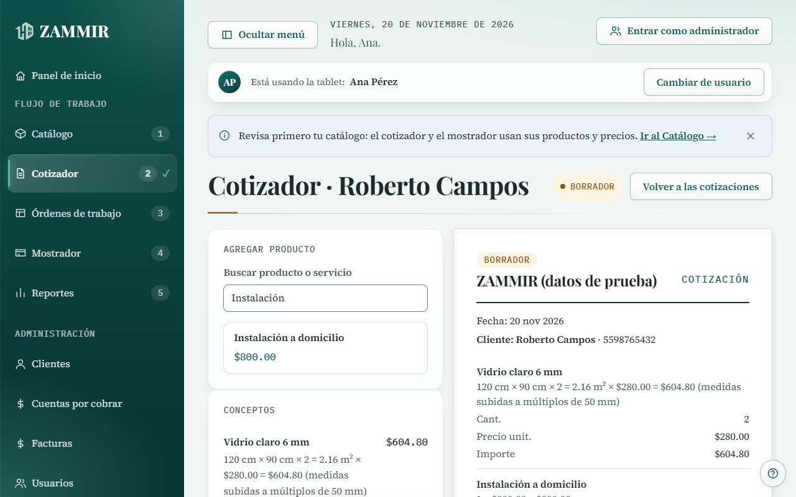

   **Cantos, perforaciones, biselados.** En una línea de vidrio toca **Cargo extra**, elige el cargo (por ejemplo, *Canto pulido*) y, si se cobra por pieza, cuántas (por ejemplo, 2 perforaciones). Toca **Agregar a la línea**: el cargo se calcula con la medida de esa pieza (por m², por metro lineal, del perímetro o del largo según el cargo, o por pieza) y se suma al importe de la línea. Se ve en el detalle de la línea y se quita con **Quitar**. Los cargos extra se dan de alta en el **Catálogo** con el tipo *Cargo extra*; no salen en el buscador porque no se venden solos.
5. Toca **Emitir cotización**. Queda con un **folio provisional** (algo como `T1-0001`), un **código** y una fecha de **vigencia**. Una vez emitida **ya no se puede cambiar**: si necesitas otra versión, toca **Duplicar**.

   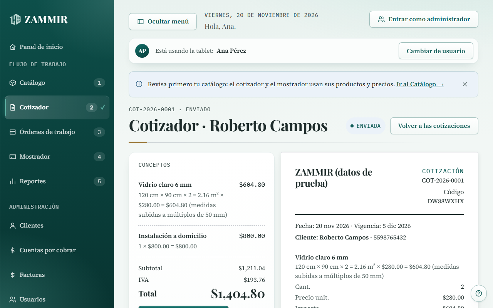

6. **Envíala** con **Enviar por WhatsApp**, el botón principal: se prepara el PDF en hoja tamaño carta, con el logo y el detalle, y eliges WhatsApp en el menú. Si tu tablet no tiene menú de compartir, se descarga el PDF y se abre WhatsApp con el mensaje. Junto a ese botón está **Imprimir**, para cuando el cliente la pida en papel (ver *Imprimir un documento*, más abajo).
7. Cuando el cliente responda, toca **Marcar como aceptada** o **Marcar como rechazada**.

**Descuentos.** **Dar descuento** pide el **PIN de un administrador**. El nuevo precio nunca puede ser mayor que el del catálogo ni negativo.

**Precio abierto.** Algunos productos, como una reparación *que depende del trabajo*, tienen un precio **de referencia**. En su línea toca **Fijar precio** y escribe el precio por unidad: cualquier persona puede dejarlo en la referencia o arriba, y la línea dice *precio fijado*. Si lo dejas **debajo** de la referencia es un descuento y pide el **PIN de un administrador**.

**Estados de una cotización:** Borrador, Enviada, Aceptada, Rechazada y Vencida. Las cotizaciones de cada cliente se ven en su historial.

> **Folio provisional y definitivo.** Mientras la tablet no ha enviado el documento, su folio es provisional (`T1-…`). Al enviarlo, el servidor le pone el folio definitivo. Sin internet no hay problema: nada se duplica.

---

## 3. Vender en el mostrador

El **Mostrador** es para ventas inmediatas (piezas, servicios y vidrio a medida) y para cobrar al momento. **Necesitas un turno de caja abierto** para cobrar.

### Abrir tu turno

1. Entra a **Mostrador**. En *Mi turno de caja* escribe tu **fondo inicial** (el efectivo con que abres el cajón; es opcional) y toca **Abrir turno**.

   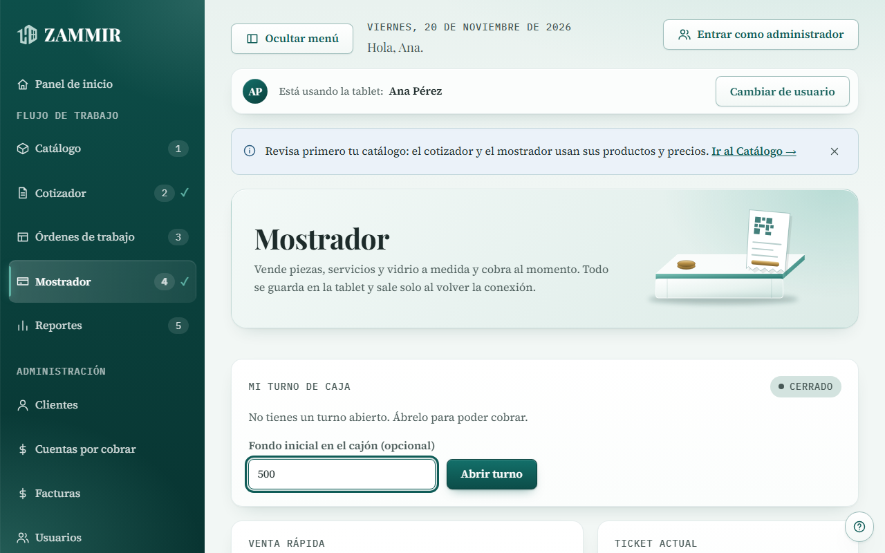

### Hacer una venta

1. En *Venta rápida* busca el producto. Una **pieza estándar** se agrega al **Ticket actual** con solo tocarla; lo que va **a medida** pide ancho, alto y cantidad. Lo que se vende **con decimales** (por ejemplo, *1.5 kilos*) y los **paquetes** abren su formulario para que escribas la cantidad.
2. En el ticket puedes cambiar la cantidad (**Una más** / **Una menos**), **Quitar** un producto o **Vaciar el ticket**.
   - **Cargo extra:** en una línea de vidrio toca **Cargo extra** y agrega el canto, la perforación o el biselado, igual que en el cotizador. Se quita con **Quitar**.
   - **Precio abierto:** toca **Fijar precio** en la línea. En el mostrador solo se fija en la referencia o arriba; los descuentos se dan en el cotizador, con el PIN de un administrador.

   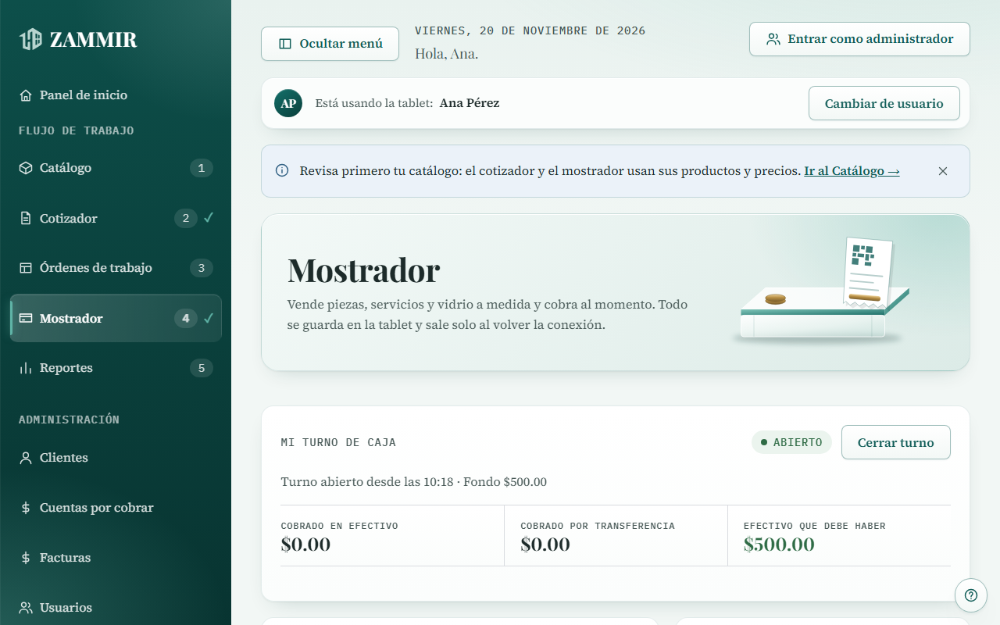

3. Toca **Cobrar**. Captura cómo paga el cliente:
   - **Efectivo recibido:** lo que te da. El sistema calcula el **cambio**.
   - **Efectivo que se aplica** y **Transferencia:** si paga **mixto**, reparte el total entre efectivo y transferencia (puedes anotar la **referencia** de la transferencia).

   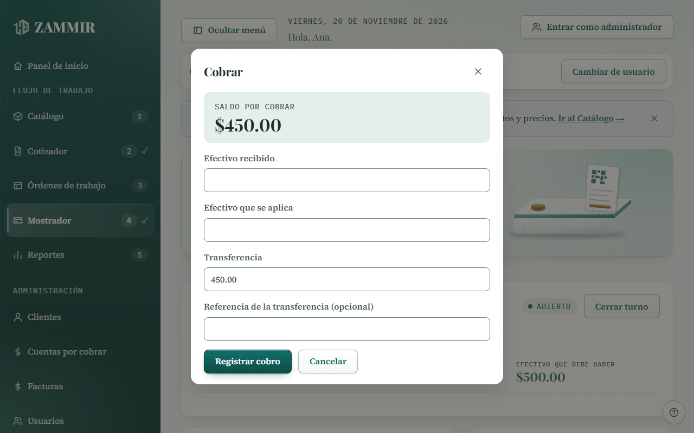

4. Toca **Registrar cobro**. Aparece **Venta registrada**, con su folio provisional, el **cambio** y la leyenda *"Guardada en la tablet"*. Toca **Enviar por WhatsApp** para mandar el comprobante (hoja tamaño carta con el logo y el detalle de la venta). Si el cliente lo pide en papel, toca **Imprimir**. Si la venta no tiene el teléfono del cliente, se abre WhatsApp para que elijas a quién mandarlo.

   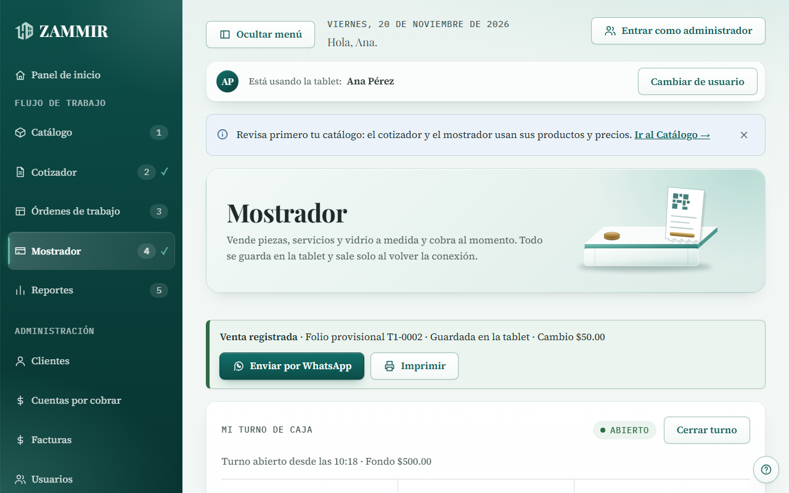

> Si te equivocas en una venta, **no se borra**: se cancela con motivo y queda el rastro.

---

## 4. Órdenes de trabajo

Una **orden de trabajo** es un trabajo aceptado que se fabrica o instala. Lleva su **anticipo**, su **saldo** y su **garantía**.

### Crear la orden

1. En **Órdenes de trabajo** verás las *Cotizaciones aceptadas por convertir*. Toca **Crear orden de trabajo** en la que sigue. El sistema te pide la **fecha estimada de entrega** (el día en que queda lista para entregar o instalar); elígela en el calendario y toca **Crear la orden**. Sin fecha no se crea.

   **Si el trabajo se entrega por partes** (por ejemplo, primero las ventanas y después el cancel), marca **¿Se entrega por partes?** y deja marcadas solo las líneas de esta parte. Se crea una orden con esas líneas, con su propio anticipo, cobros y fecha. Las demás líneas siguen en *Cotizaciones aceptadas por convertir* (dice "Faltan N líneas") para crear la siguiente parte cuando toque. Cada parte sale en la lista como **Parte 1**, **Parte 2**…, y en su detalle hay botones para ver las demás partes. Una línea solo puede ir en una parte.

   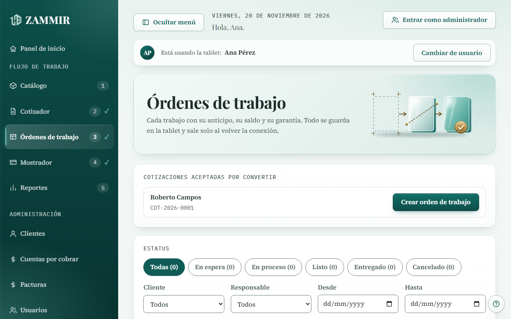

2. Se abre la orden, con su folio (por ejemplo `OT-2026-0001`), los conceptos y el recuadro **Cobro y saldo**: total, **anticipo exigido**, pagado y saldo.

   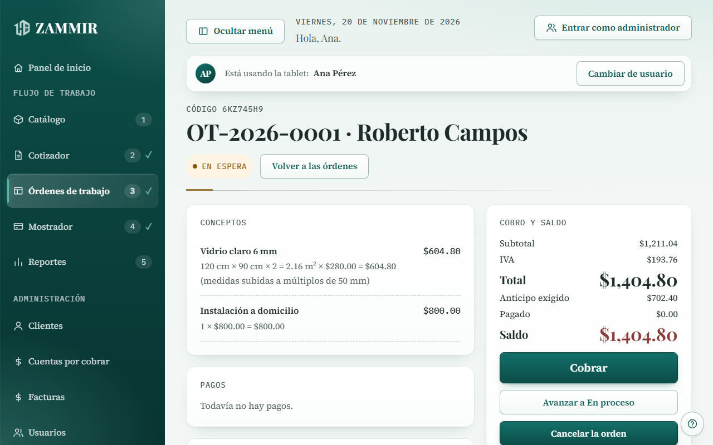

### Cobrar el anticipo

1. Toca **Cobrar**. El sistema te sugiere el **anticipo** (por defecto, la mitad).
2. Escribe el efectivo recibido y/o la transferencia, igual que en el mostrador. Toca **Registrar cobro**.

   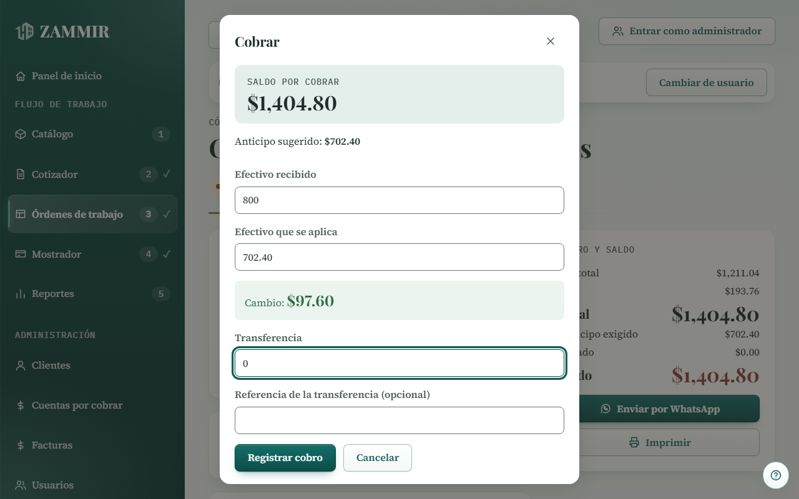

3. El pago aparece en la lista de **Pagos** y el saldo baja.

   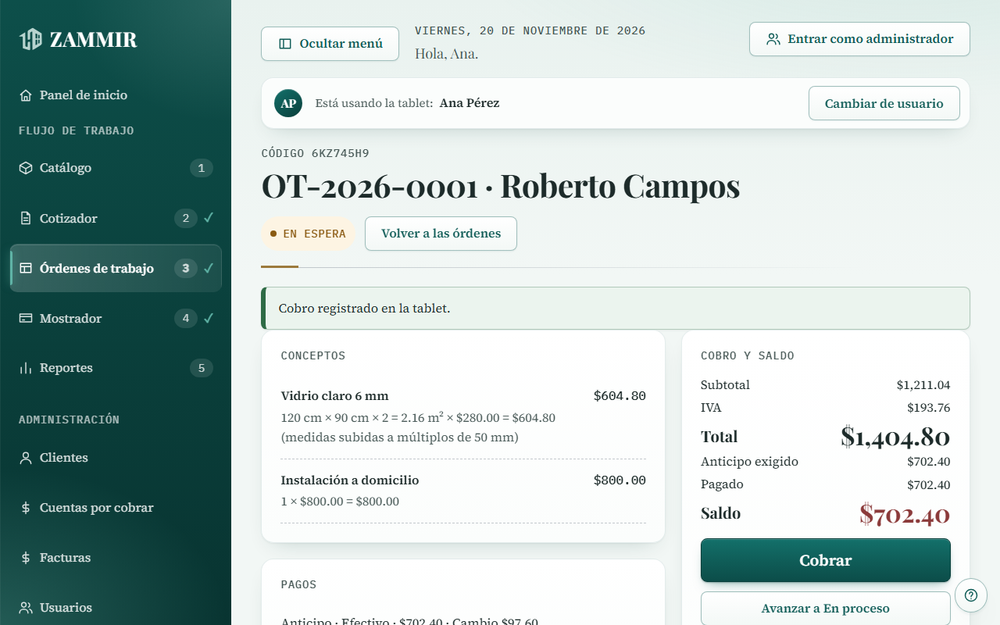

> **Para cobrar necesitas tu turno de caja abierto.** Si no, el sistema te dice *"Todavía no abres tu turno de caja"* y te lleva a abrirlo en el Mostrador.

### Seguir el trabajo

- En **Datos del trabajo** anota **quién mide**, **quién fabrica** y **quién instala**, y cambia la **fecha estimada de entrega** si hace falta (no se puede dejar en blanco, y una orden entregada ya no la cambia). Toca **Guardar datos**. Cada cambio de fecha queda en la bitácora.
- Si hoy ya pasó la fecha y la orden no se ha entregado, sale con la etiqueta **Atrasada**. En la lista, el botón **Atrasadas** deja solo esas; el panel de inicio dice cuántas hay.
- Avanza el estatus con **Avanzar a**: **En espera → En proceso → Listo → Entregado**.
- **Empezar sin anticipo** necesita el **PIN de un administrador**.
- **Entregar con saldo pendiente** necesita el **PIN de un administrador** y un **motivo**.
- **Cancelar la orden** necesita el **PIN de un administrador** y un **motivo**. Nada se borra. El **anticipo no se devuelve solo**: si la orden estaba *En espera*, se recomienda devolverlo completo; si ya estaba *En proceso* o *Listo* (con el material cortado), se queda para cubrir material y mano de obra, y Luis o Ricardo pueden devolver una parte. Escribe en el motivo lo que se decidió. Si devuelves efectivo, sale de tu cajón: anótalo en la explicación de tu corte.
- **Comprobante:** una hoja tamaño carta con el logo, el folio, el detalle, el saldo y la garantía. Se manda con **Enviar por WhatsApp** o se imprime con **Imprimir**, igual que una cotización.

---

## 5. Cuentas por cobrar

**Cuentas por cobrar** lista las órdenes con saldo pendiente, **de la más atrasada a la más reciente**. Los días se cuentan **desde la entrega**: lo que se entregó hoy y no se ha pagado está al corriente, y **desde el día siguiente sale como atrasado**. Las órdenes que todavía no se entregan aparecen como **Por entregar** (su saldo aún no se cobra). Desde ahí toca **Registrar pago**. A partir de cuántos días se resalta una cuenta lo cambia un administrador en **Configuración**, en *Cuentas por cobrar atrasadas* (por omisión, 1 día). No es crédito: es el seguimiento de lo que falta por cobrar de trabajos ya en marcha.

**Transferencias por confirmar.** Abajo, en la misma pantalla, salen los pagos por transferencia que todavía nadie confirma, de la más antigua a la más reciente, con su folio, importe y referencia. Revisa en tu banco que llegó cada una y toca **Ya llegó**. Queda quién la confirmó y cuándo (también sin internet; se envía sola). En el detalle de cada orden, cada transferencia dice **Por confirmar** o **Confirmada**. Confirmar no cambia los totales: la transferencia cuenta desde que se cobró.

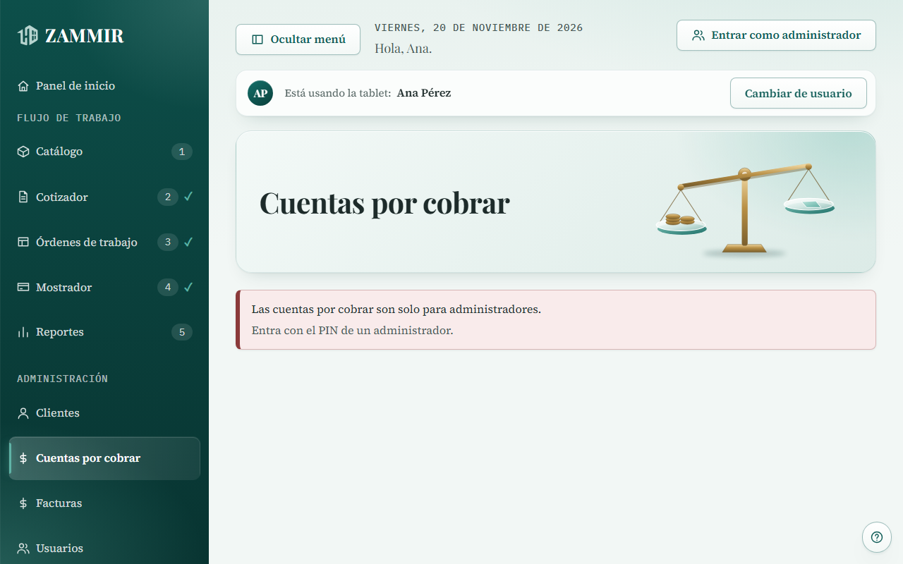

---

## Imprimir un documento

Las cotizaciones, los comprobantes de trabajo, las ventas de mostrador y el corte de caja salen **en hoja tamaño carta**, con el logo de ZAMMIR y el detalle. **No se usa impresora de tickets.**

- **Enviar por WhatsApp** es el botón principal; **Imprimir** está siempre a su lado. Imprime solo cuando el cliente lo pida.
- Al tocar **Imprimir** se abre la impresión de la tablet: elige la **impresora de Wi-Fi** y confirma.
- Si una **venta de mostrador** ya se imprimió antes en esa tablet, la hoja sale marcada **COPIA** para que no se confunda con el original.
- Si la impresión no abre, **guarda el PDF** o **mándalo por WhatsApp** y vuelve a intentarlo después. Nada se pierde.

---

## 6. El corte de caja

Al terminar tu turno:

1. En **Mostrador**, en *Mi turno de caja*, revisa lo **cobrado en efectivo**, lo **cobrado por transferencia** y el **efectivo que debe haber**.
2. Toca **Cerrar turno**, cuenta el efectivo del cajón y escribe el **efectivo contado**.

   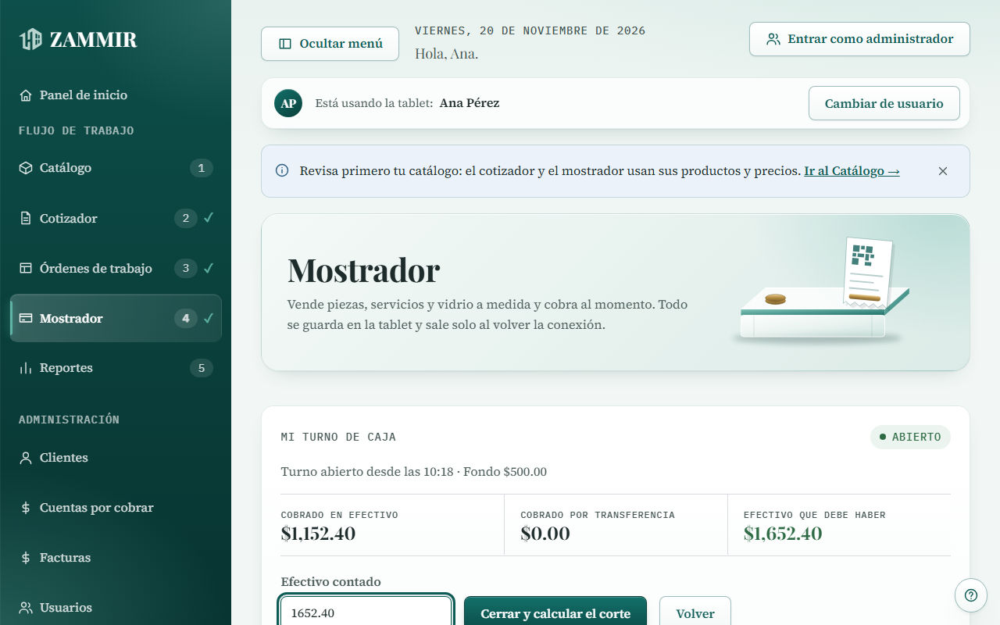

3. Toca **Cerrar y calcular el corte**. Si sobra o falta dinero, **aunque sea un centavo**, el sistema te muestra la diferencia y te pide **explicar por qué** antes de cerrar (por ejemplo, "di mal un cambio"). Escribe la explicación y toca **Cerrar el turno con esta explicación**. Si te equivocaste al contar, corrige el efectivo contado y vuelve a tocar **Cerrar y calcular el corte**.
4. El sistema muestra el **efectivo esperado**, el **contado** y la **diferencia**: **Exacto**, **Sobrante** o **Faltante**. Aparece la hoja del corte en tamaño carta: toca **Enviar por WhatsApp** (por ejemplo, para mandársela a Luis) o **Imprimir**. Si ya cerraste el turno y quieres verla otra vez, en *Mi turno de caja* toca **Ver corte**.

   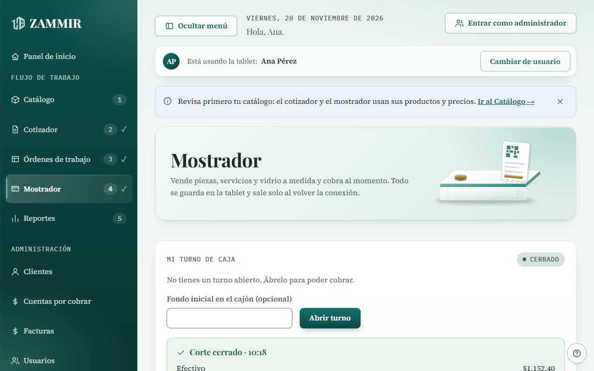

- **Cancelar una venta ya cobrada** (en *Ventas de hoy*, botón **Cancelar venta**, con el PIN de un administrador y un motivo): el sistema te dice cuánto se le devuelve al cliente y por qué medio, **el mismo con que pagó**. Necesitas tu turno abierto: el efectivo devuelto **sale de tu cajón** y aparece en tu corte como *Efectivo devuelto*. El cobro original se queda en el turno donde se cobró, así que un corte ya cerrado no cambia.
- En los reportes, el cobro cuenta el día en que se cobró y la devolución resta el día en que se hizo.
- La explicación de la diferencia sale en la hoja del corte y en la tabla de turnos.
- Cada cajero ve **solo su corte**; los administradores ven los de todos.
- Si hay operaciones **sin enviar**, el corte puede cambiar cuando lleguen al servidor; un administrador debe revisarlo.

---

## 7. Reportes (administradores)

Entra con el **PIN de un administrador**. En el Panel de inicio ves un resumen del día; en **Reportes**, las ventas de **hoy**, **esta semana** (de lunes a domingo) y **este mes**, siempre en hora de la Ciudad de México y comparadas con el periodo anterior, además de lo más vendido y los trabajos por estatus.

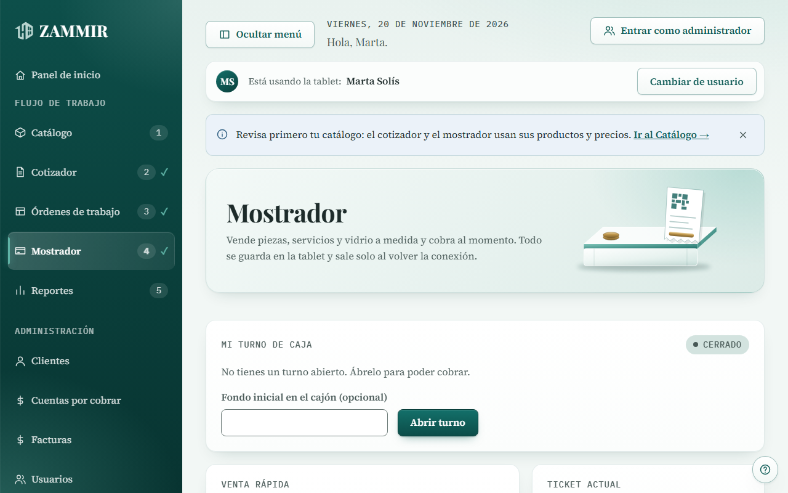

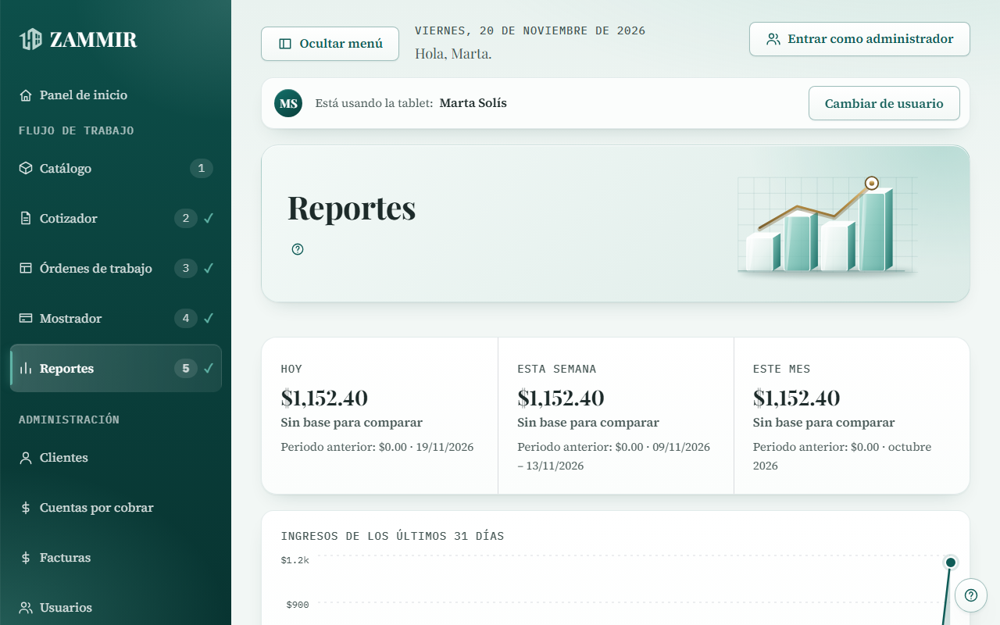

> En los reportes, **"ventas" es el efectivo y las transferencias recibidas**: lo cobrado en el mostrador más los pagos de las órdenes. No incluye lo que todavía te deben. Si se cancela una venta, la devolución resta el día en que se hizo.

---

## 8. Administración en la computadora

Estas secciones son **solo para administradores**. Entra con tu **correo y contraseña**.

### Usuarios y tablets

Aquí das de alta a las personas del mostrador, les asignas **rol** y **PIN**, y registras las tablets.

- **Dar de alta:** nombre, rol (*Administrador* o *Cajero / vendedor*) y PIN: de 4 a 6 dígitos para un cajero / vendedor y de **6 dígitos** para un administrador. **No uses números fáciles** como `0000` o `1234`; el sistema no los acepta. Cada persona escribe su PIN en persona.
- **Restablecer PIN**, **Desactivar** / **Activar**: nadie se borra; quien ya no trabaja se desactiva y su historial se conserva.
- **Bitácora:** quién hizo qué, desde qué tablet y cuándo. Solo se consulta.
- **Tablets:** **Generar código** para una nueva y **Revocar** las que ya no se usen (se conserva su registro).

### Clientes

La **ficha del cliente** reúne sus cotizaciones, órdenes, ventas, pagos y garantías, y marca si es **recurrente** (dos o más trabajos entregados).

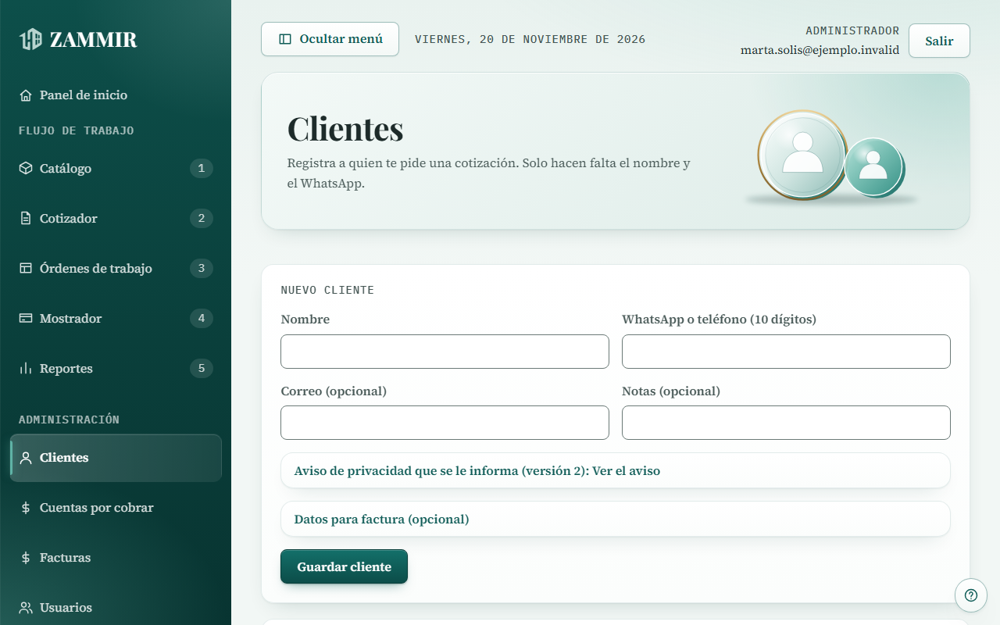

### Catálogo

Tus **productos y precios de lista, con IVA incluido**. Lo que cambies aquí se usa en el cotizador y en el mostrador. Puedes **Agregar producto**, **Editar**, **Duplicar**, **Desactivar** (nunca se borran) o **Importar desde archivo**.

Al dar de alta o editar un producto, además del nombre, el tipo, cómo se cobra y el precio, puedes capturar:

- **Descripción** (opcional, hasta 500 caracteres): qué incluye o para qué sirve. Se busca con ella, se ve en el buscador y sale en el documento del cliente.
- **Unidad de venta** (solo lo que se cobra por pieza o servicio): *rollo*, *kilo*, *par*, *hora*… Se sugieren las de **Configuración** y las que ya usa el catálogo, para que todos escriban igual.
- **Se vende con decimales:** para lo que se cobra por kilo o por hora. Necesita la unidad de venta. La cantidad lleva hasta 3 decimales y se cobra al centavo.
- **Precio abierto:** el precio de lista queda como referencia y se fija al cotizar o vender (ver *Cotizar*).
- **Ajustes del cobro** (solo m² y metro lineal, todos opcionales): subir cada medida a múltiplos de unos milímetros, un área mínima por pieza, un cobro mínimo por trabajo y la **medida máxima**. Vacíos, se cobra la medida exacta, sin mínimo.
- **Clave SAT y clave de unidad SAT** (opcionales). Vacías, se usan las de la categoría.

**Duplicar** abre el formulario con todo copiado, menos el código, y el nombre con *(copia)*: sirve para dar de alta otro espesor, tono o acabado sin capturar todo de nuevo.

**Paquetes.** Con el tipo *Paquete (varios productos)* eliges los productos que lleva y cuántos de cada uno. No tiene precio propio: vale lo que sus productos. Un paquete no lleva otros paquetes, cargos extra ni productos desactivados.

**Precios en bloque** (botón arriba, solo administradores). Primero ves cada cambio, antes y después, y nada se guarda hasta que lo apliques; cada cambio de precio queda en el historial del producto.

- **Subir o bajar por porcentaje** una categoría completa (solo los productos activos). Escribe el porcentaje (para bajar, con un menos: *-5*) y elige cómo redondear al peso: **hacia arriba** (recomendado), al más cercano o hacia abajo.
- **Actualizar desde un archivo:** toca **Descargar el catálogo de hoy**, cambia en Excel el nombre, el precio o la descripción y súbelo. Cada producto se encuentra por su código; una celda vacía deja lo que ya tenía. Con un solo error en el archivo no se cambia nada, y el error se muestra con su fila.

**Importar desde archivo** sirve para **dar de alta** productos nuevos. La plantilla trae, además, columnas opcionales para la descripción, la unidad de venta, las claves SAT y los ajustes del cobro. Los paquetes se dan de alta en la pantalla.

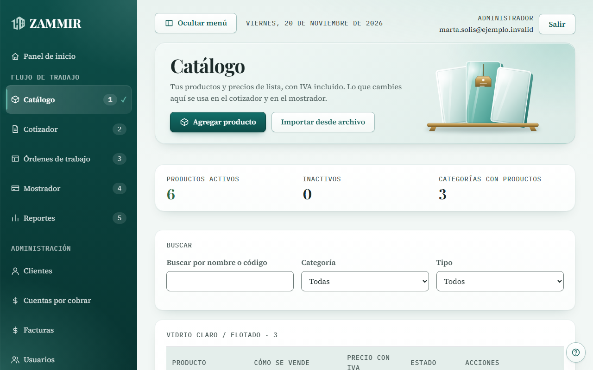

**Categorías.** Abajo, en la tarjeta *Categorías*, puedes **agregar** una categoría nueva (por ejemplo, "Canceles comerciales" o "Vitrales"; elige si lo de ella se cobra por metro cuadrado, por pieza o como servicio), **renombrarla**, **subirla o bajarla** en la lista y **desactivarla**. No se borran. Una categoría con productos activos no se desactiva: primero cámbialos de categoría o desactívalos. Una categoría desactivada ya no se ofrece al dar de alta productos ni al importar. No se repiten nombres, aunque cambien los acentos o las mayúsculas.

### Configuración

Aquí se edita el **aviso de privacidad** (cada cambio crea una versión nueva y las anteriores se conservan), los **términos del servicio**, las **condiciones de la cotización** y las **unidades de venta** que se sugieren al capturar un producto (una por renglón). El texto inicial del aviso lo preparó HummingX; ZAMMIR puede ajustarlo con su asesor cuando quiera.

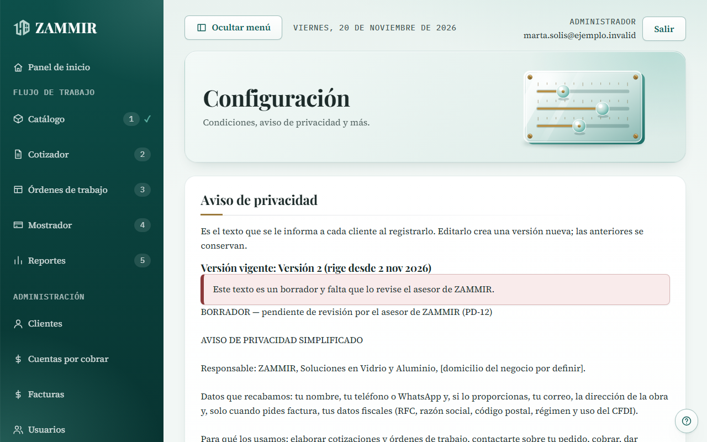

### Exportar los datos

Al final de **Configuración** está **Exportar los datos**. Sirve para llevarte **toda la información del negocio** (clientes, productos, cotizaciones, órdenes, ventas, pagos y bitácora) en archivos que abre cualquier programa.

1. Toca **Preparar la exportación** y espera a que diga *Listo*.
2. Elige qué descargar: **Descargar todo (ZIP)**, **Descargar JSON**, **Descargar CSV (ZIP)** (una tabla por archivo, para Excel) o **Descargar PDF** (un resumen para leer e imprimir).
3. Abre el archivo `LEEME.txt` que viene dentro: explica cómo leer los importes (están en centavos) y las fechas.

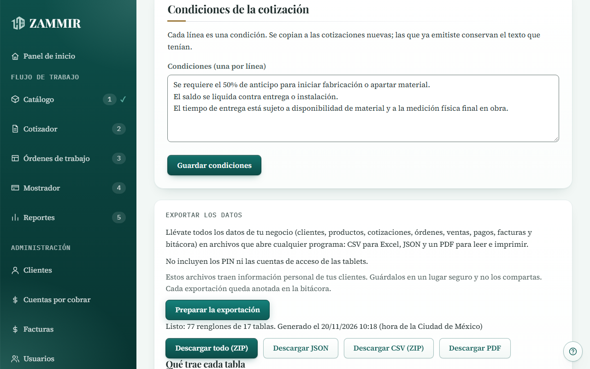

> **Cuidado:** estos archivos traen **información personal de tus clientes**. Guárdalos en un lugar seguro y no los compartas. **No incluyen los PIN** ni las cuentas de las tablets. Cada exportación queda anotada en la bitácora, con quién la hizo.

---

## 9. Cuando algo no sale como esperas

| Qué ves | Qué hacer |
|---|---|
| *"Esta tablet todavía no tiene el catálogo ni la lista de personas."* | Conéctala a internet unos minutos y vuelve a abrir la aplicación. |
| *"El PIN no es correcto"* | Revísalo y vuelve a intentar. Si lo olvidaste, pide a un administrador que lo restablezca. |
| *"Todavía no abres tu turno de caja"* | Ve al **Mostrador** y toca **Abrir turno**. |
| *"Falta la autorización de un administrador"* | Pide a un administrador que teclee su PIN. |
| *"Esta cotización ya se emitió y no se puede cambiar"* | Toca **Duplicar** y haz una nueva. |
| *"Guardada en la tablet"* | Está bien guardado; saldrá solo cuando haya internet. |
| *"Hay N operaciones sin enviar"* | Conecta la tablet a internet. No borres nada. |
| *"Esta pantalla tuvo un problema"* | Toca **Volver a abrir**. Lo que ya guardaste no se pierde. Avisa a soporte de HummingX. |

**Soporte de HummingX BI:** por WhatsApp o correo (los datos vienen en tu guía rápida), de **lunes a viernes, de 9:00 a 21:00**. Di qué pantalla estabas usando, a qué hora y el folio (si lo hay). **Nunca** mandes por mensaje tu PIN ni tu contraseña.

---

## Palabras que usamos

| Palabra | Qué significa |
|---|---|
| **Anticipo** | El primer pago de un trabajo, por defecto la mitad, para empezar a fabricar. |
| **Saldo** | Lo que falta por pagar: el total menos lo pagado. |
| **Cotización** | El presupuesto formal con folio, vigencia y condiciones. |
| **Orden de trabajo** | Un trabajo aceptado que se fabrica o instala. |
| **Venta de mostrador** | Una venta inmediata, sin orden de trabajo. |
| **Corte de caja** | El cierre de tu turno: esperado, contado y diferencia. |
| **Folio provisional** | El número que lleva un documento mientras la tablet no lo ha enviado (`T1-0001`). |
| **Cliente recurrente** | Un cliente con dos o más trabajos entregados. |

---

## Anexo · Facturación (en pausa)

> **Esta parte no se usa todavía.** La facturación electrónica está construida pero **en pausa** hasta que ZAMMIR tenga en orden sus datos fiscales; mientras tanto, su contador sigue facturando. Se conserva aquí para el día en que se active.

### Facturas (administradores)

En **Facturas** hay dos pestañas: **Por facturar** y **Emitidas**. Arriba ves cuántas hay por facturar y los **timbres del año**.

> **Importante:** mientras no se conecte el proveedor de timbrado real y el certificado de ZAMMIR, las facturas son **de prueba y no tienen validez fiscal**.

#### Facturar una venta u orden

1. En **Por facturar** aparecen las ventas y órdenes **ya liquidadas** que no tienen factura. Toca **Facturar**.

   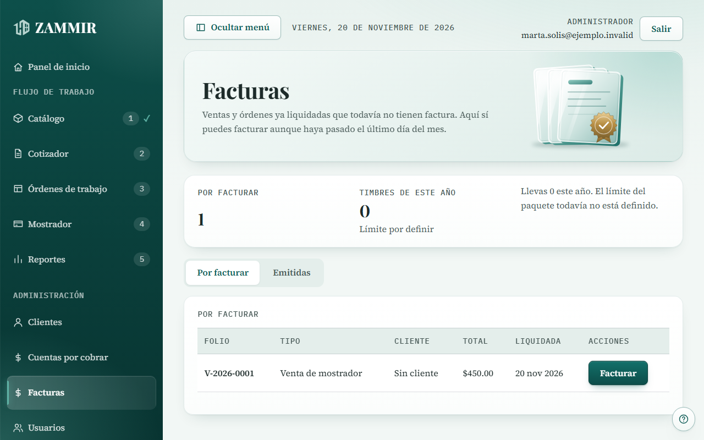

2. Revisa los datos del cliente: **RFC**, **nombre o razón social**, **código postal fiscal**, **régimen fiscal** y **uso de la factura**. Si el cliente ya tiene datos fiscales en su ficha, vienen precargados y los puedes corregir.
3. Si el cliente pagó **mixto**, el sistema te pide **elegir la forma de pago**.

   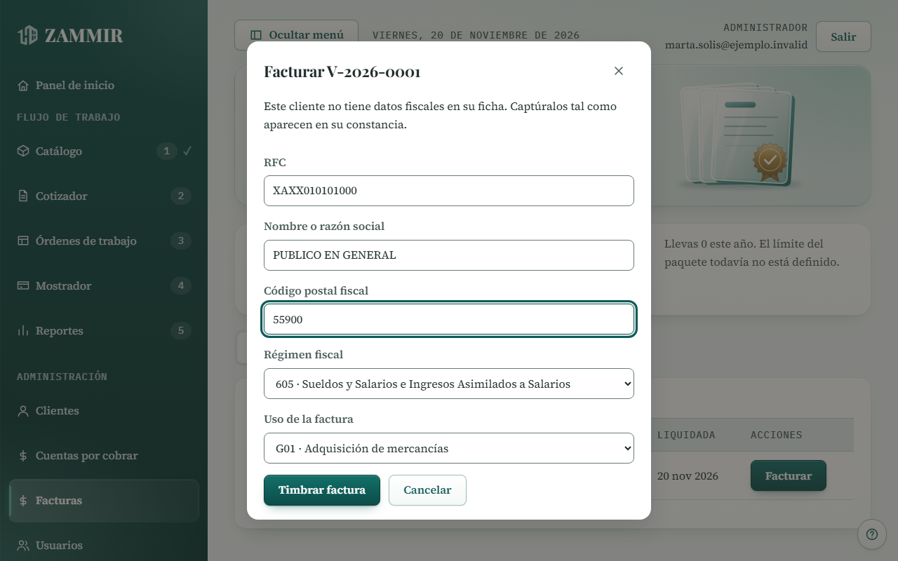

4. Toca **Timbrar factura**. Obtienes el folio (por ejemplo `F-2026-0001`) y puedes bajar el **PDF** y el **XML**, o **Enviar por WhatsApp**.

   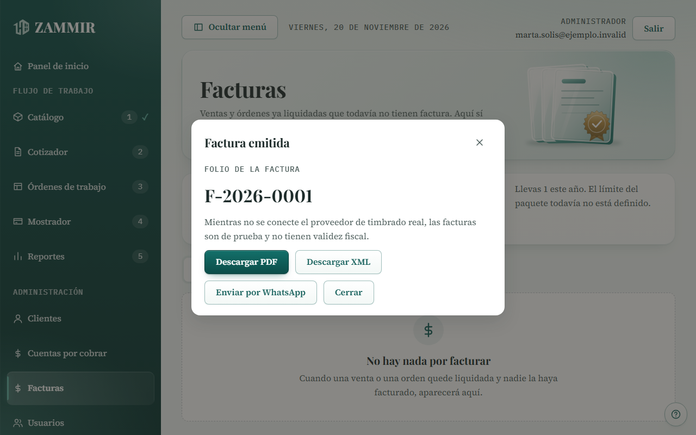

- Aquí **sí puedes facturar aunque haya pasado el último día del mes** (el cliente, en el portal, no).
- Una venta **ya facturada** no se puede facturar otra vez.

#### Revisar, descargar y cancelar

En **Emitidas** ves cada factura con su estado: **Vigente**, **Cancelada**, **En proceso** (el proveedor de timbrado no contestó; se reintenta y **nunca se timbra dos veces**; puedes tocar **Reintentar**) o **Rechazada**.

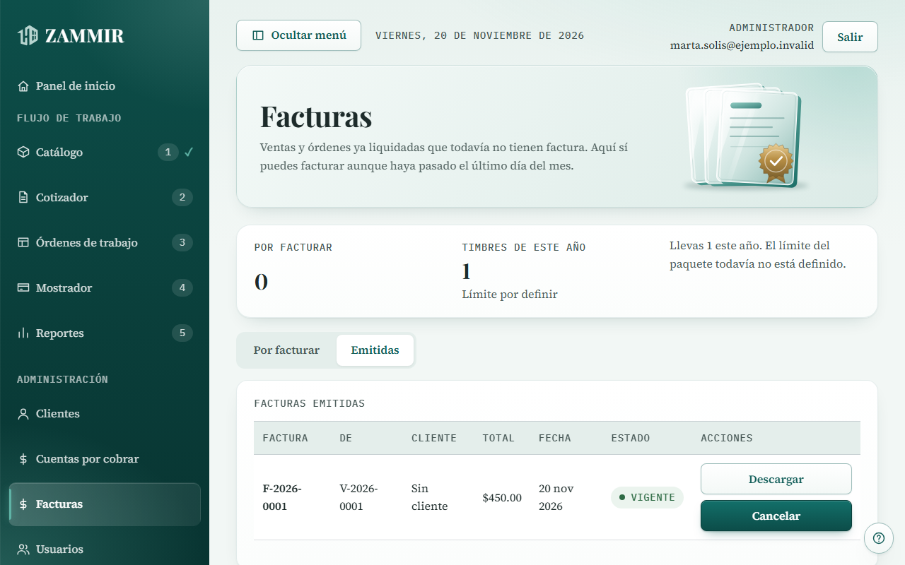

**Cancelar** una factura mal emitida (por ejemplo, un RFC equivocado): toca **Cancelar**, elige el **motivo** del SAT (si es el 01, escribe el folio de la factura que la sustituye) y confirma. **Nada se borra**: la factura queda marcada como cancelada, con el motivo y quién la canceló. Después puedes volver a facturar la venta u orden.

---

### Cuando el cliente pide su factura

> **En pausa.** Mientras la facturación esté apagada, los documentos no traen QR y el portal no está disponible. Si un cliente pide factura, anota sus datos y avisa a un administrador.

Cada **ticket** y cada **comprobante de trabajo** trae un **QR**. El cliente lo escanea con su teléfono y llega al portal **Pide tu factura**, sin cuenta ni contraseña.

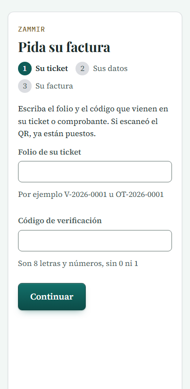

1. Escribe el **folio** y el **código de verificación** (si escaneó el QR, ya están puestos).
2. Captura sus **datos fiscales** y recibe su factura.

El cliente puede pedirla **hasta el último día del mes** de su compra. Después, o si el portal no puede, un administrador la factura desde **Facturas**. Si el portal le dice que no encuentra su compra, puede ser que la tablet todavía no la haya enviado: conéctala a internet.
